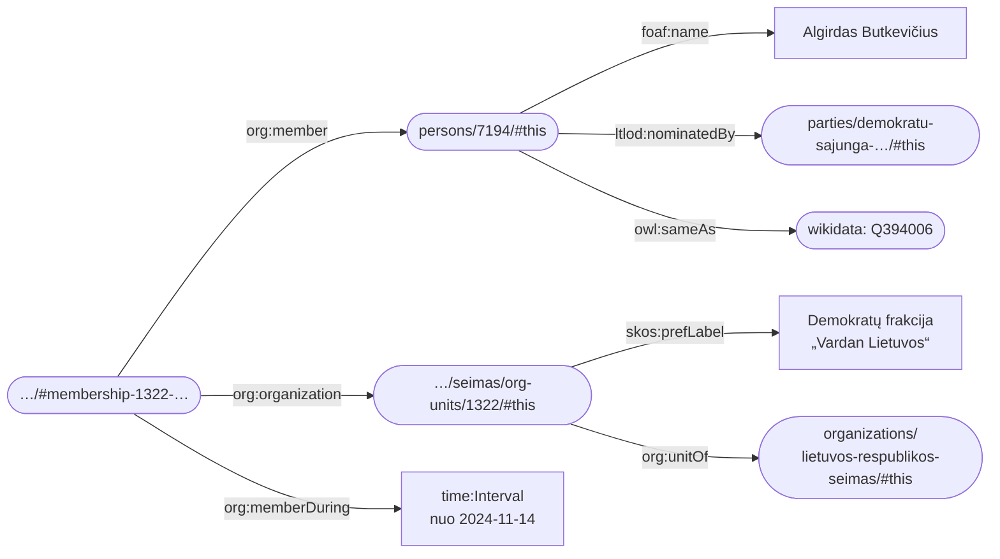
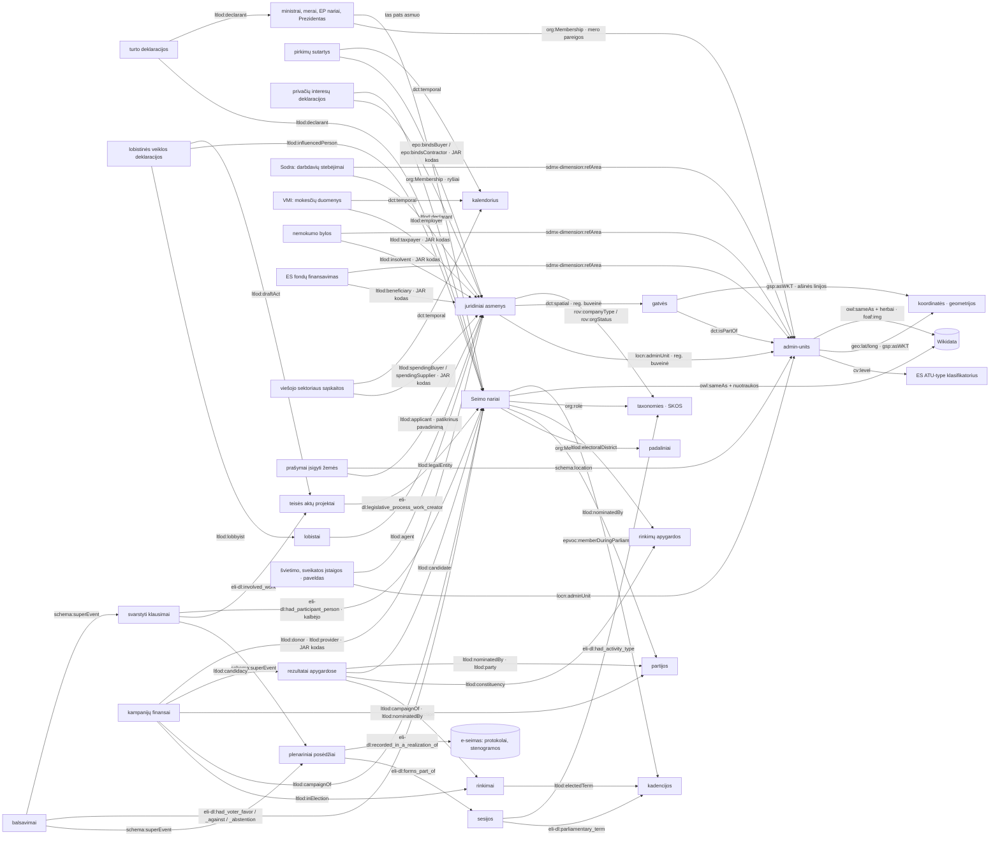
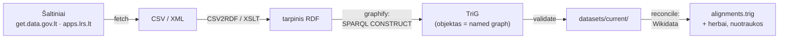

# LTLOD — Lietuvos susietieji atvirieji duomenys

LTLOD tikslas — **lietuviškas Knowledge Graph**: Lietuvos atvirieji duomenys, sujungti į vientisą,
standartais grįstą RDF grafą, kurį galima užklausti, papildyti ir susieti su pasauliniais
duomenimis (Wikidata, ES žodynais).

Rinkiniai publikuojami adresu **<https://linkeddata.lt/>**: kiekvieną objektą galima naršyti
kaip Linked Data dokumentą, o SPARQL užklausas teikti per <https://linkeddata.lt/sparql>.

Šiame repozitoriuje yra:

- **atkuriamos (re-runnable) ETL grandinės** ([`etl/`](etl/)), kurios kiekvieno paleidimo metu
  parsisiunčia **aktualius** duomenis iš oficialių šaltinių ir sugeneruoja RDF rinkinius;
- **sugeneruoti duomenų rinkiniai** ([`datasets/current/`](datasets/current/)) — beveik milijonas
  RDF ketvertų apie administracinius vienetus, Seimo narius, įstaigas;
- **SPARQL užklausų pavyzdžiai** su rezultatais ([`queries/EXAMPLES.md`](queries/EXAMPLES.md)).

## RDF trumpai

[RDF](https://www.w3.org/TR/rdf11-primer/) — W3C standartas duomenims užrašyti **grafo** pavidalu.
Kiekvienas faktas yra trejetas *subjektas → predikatas → objektas*, o objektai identifikuojami
**URI adresais**, kurie galioja viso interneto mastu. Dėl to skirtingi rinkiniai susijungia
savaime — užtenka, kad jie naudotų tuos pačius URI.

Štai tikri duomenys iš šio repozitorijaus (Seimo narys, jo frakcija ir partija):



Narystė čia — atskiras objektas su galiojimo intervalu (`org:Membership` + `time:Interval`),
todėl grafas saugo ne tik dabartinę būseną, bet ir **istoriją**: pasikeitus pareigoms, sena
narystė gauna pabaigos datą, o nauja — pradžios.

Kiekvienas objektas gyvena savo **named graph'e** (dokumente), kurio URI sutampa su dokumento
adresu. Štai Birštono savivaldybės dokumentas ([TriG](https://www.w3.org/TR/trig/) sintakse;
čia parodyta išskleista absoliuti forma — užfiksuoti failai naudoja santykines URI, pvz.
`<admin-units/12/#this>`, o bazė pritaikoma krovimo metu; Wikidata susiejimai ir herbas
prijungti iš `alignments.trig`, koordinatės ir riba iš `*-geo.trig` praleistos):

```turtle
<https://linkeddata.lt/admin-units/12/> {
    <https://linkeddata.lt/admin-units/12/>
        a dh:Item ;                                             # LinkedDataHub dokumentas
        sioc:has_container <https://linkeddata.lt/admin-units/> ;
        dct:title "Birštono savivaldybė"@lt ;
        dct:created "2026-10-13T01:12:44.490+02:00"^^xsd:dateTime ;   # ETL paleidimo laikas
        foaf:primaryTopic <https://linkeddata.lt/admin-units/12/#this> .

    <https://linkeddata.lt/admin-units/12/#this>
        a cv:AdminUnit ;                                        # ES Core Location klasė
        cv:level atu-type:LTU_SV ;                              # ES klasifikatorius: savivaldybė
        skos:prefLabel "Birštono savivaldybė"@lt ;
        skos:notation "12" ;                                    # natūralus raktas iš Adresų registro
        dct:isPartOf <https://linkeddata.lt/admin-units/2/#this> ;   # → Kauno apskritis
        owl:sameAs <http://www.wikidata.org/entity/Q2015893> ;  # → Wikidata
        foaf:img <https://commons.wikimedia.org/wiki/Special:FilePath/Birstonas%20COA.svg> ;  # herbas
        schema:validFrom "1998-06-01"^^xsd:date .
}
```

Užklausoms naudojama [SPARQL](https://www.w3.org/TR/sparql11-overview/) — standartinė RDF užklausų
kalba (kaip SQL reliacinėms DB). Pavyzdžiai — [žemiau](#ką-jau-galima-atsakyti).

## Duomenų rinkiniai

| Rinkinys | Objektai | Šaltinis |
|---|---|---|
| [`admin-units`](datasets/current/admin-units/) | 10 apskričių, 60 savivaldybių, 584 seniūnijos, 26 229 gyvenamosios vietovės ir 61 149 gatvės (`streets`) | Adresų registras per [get.data.gov.lt](https://get.data.gov.lt/) |
| [`seimas`](datasets/current/seimas/) | 831 visų kadencijų nuo 1990 m. Seimo narys (148 — dabartinėje) su ~21 000 kadencijų, pareigų ir narysčių (galiojimo intervalai), 394 padaliniai (frakcijos, komitetai, komisijos, parlamentinės grupės), 66 partijos, 771 vienmandatė apygarda (pagal kadenciją); Seimo kalendorius nuo 1990 m.: 10 kadencijų, 131 sesija ir 4 771 plenarinis posėdis su protokolais ir stenogramomis; pasirinktinai (`make -C etl/seimas votes`, numatytai — dabartinė kadencija) plenarinių posėdžių balsavimai: 10-ojoje kadencijoje 5 633 balsavimai su ~336 000 Seimo narių individualių balsų (už / prieš / susilaikė); pasirinktinai (`make -C etl/seimas bills`, ta pati kadencija) teisės aktų projektai ir svarstyti klausimai: 10-ojoje kadencijoje 2 086 projektai (799 — Seimo narių inicijuoti, su iniciatoriais) ir 4 766 plenariniuose posėdžiuose svarstyti klausimai su stadija, svarstytais projektais, kalbėjusiais Seimo nariais ir e-seimas dokumentu; balsavimai susieti su klausimu, kuriuo balsuota | [apps.lrs.lt](https://www.lrs.lt/) XML API |
| [`officials`](datasets/current/officials/) | viešųjų pareigų ėjimas nuo 1990-03-11: 7 Respublikos Prezidento kadencijos (su laikinai einančiais pareigas), 263 Ministro Pirmininko ir ministrų pareigų laikotarpiai, 134 merų kadencijos ir 88 Lietuvoje išrinktų EP narių mandatai — iš viso 350 asmenų: 162 jau yra Seimo narių rinkinyje (jų pareigos prijungiamos prie to paties asmens), 188 nauji | [Wikidata](https://www.wikidata.org/) (Prezidentas, Vyriausybė, merai; CC0) + [Europos Parlamento atvirieji duomenys](https://data.europarl.europa.eu/) (EP nariai; CC BY 4.0) |
| [`declarations`](datasets/current/declarations/) | 2 213 metinių turto deklaracijų (2012–2025 ataskaitiniai metai) — 455 asmenys: Seimo nariai, ministrai, merai, EP nariai ir Prezidentas; deklaruotos sumos pagal 23 turto rūšis (iki 2014 m. — litais, nuo 2015 m. — eurais); deklaracijos, pateiktos einant Seimo nario, ministro, viceministro, EP nario, Prezidento ar mero pareigas (viceministrų kol kas nesusiejama — jų sąrašo atviruose šaltiniuose nėra) | [VMI](https://www.vmi.lt/evmi/metines-gyventojo-seimos-turto-deklaracijos-duomenu-israsai) viešai skelbiami turto deklaracijų duomenų išrašai (renkama naršyklėje kartą per metus — žr. [`.claude/skills/harvest-declarations/`](.claude/skills/harvest-declarations/SKILL.md)) |
| [`elections`](datasets/current/elections/) | 2020 ir 2024 m. Seimo rinkimai (abu turai susieti su kalendoriaus dienomis ir išrinkta kadencija); rezultatai visose 71 vienmandatėje apygardoje — 142 apygardų rinkimai, 273 turai su rinkėjų aktyvumu, 1 719 kandidatų rezultatų (678 susieti su Seimo nariais, laimėtojai — visi), 2 272 partijų sąrašų rezultatai apygardose (sąrašų balsai, suskaičiuoti toje apygardoje); vienmandačių apygardų ribos žemėlapyje (`constituencies-geo.trig`) | [VRK](https://www.vrk.lt/) rinkimų rezultatų žemėlapio atviri ArcGIS sluoksniai ([rinkimai-vrk.opendata.arcgis.com](https://rinkimai-vrk.opendata.arcgis.com/)) |
| [`elections`](datasets/current/elections/) — politinių kampanijų finansai | Seimo rinkimų (2008–2024 ir naujų bei pakartotinių rinkimų) politinių kampanijų finansai: 1 883 kampanijų dalyviai (kandidatai, partijos, sąrašai), susieti su rinkimais, Seimo nariais (725), partijomis ir kandidatų rezultatais apygardose (485); 5 492 juridinių asmenų įnašai ir 32 269 apmokėtos juridinių asmenų paslaugos (kiekviena atskirai, su JAR kodu ir data kalendoriuje; išlaidų failas `campaign-expenses.trig` — neįtraukiamas į git, ~21 MB); fizinių asmenų aukos ir paslaugos — tik sumos pagal lėšų šaltinį ar išlaidų paskirtį (25 641 aukų įrašas → 3 741 suma) | VRK atvirieji duomenys ([data.gov.lt 2016](https://data.gov.lt/datasets/2016/), [2017](https://data.gov.lt/datasets/2017/)), renkami naršyklėje — VRK API saugo Cloudflare (žr. [`.claude/skills/harvest-vrk/`](.claude/skills/harvest-vrk/SKILL.md)) |
| [`legal-entities`](datasets/current/legal-entities/) | visas Juridinių asmenų registras — 547 382 juridiniai asmenys, iš jų 314 788 jau išregistruoti: teisinė forma, statusas, įregistravimo ir išregistravimo dienos kalendoriuje, registruota buveinė (savivaldybė, gyvenamoji vietovė, gatvė, pašto kodas, Adresų registro kodas — 217 987 iš 229 645 registruotų buveinių). Į git įtraukiamos tik 6 028 valstybės ir savivaldybių biudžetinės įstaigos (`institutions.trig`); likusieji (`entities.trig`, ~14,4 mln. ketvertų, ~1 GB) sugeneruojami `make -C etl/legal-entities entities` | JAR ir Adresų registras per get.data.gov.lt |
| [`facilities`](datasets/current/facilities/) (`heritage.trig` neįtraukiamas į git — sugeneruojamas `make -C etl/facilities`) | 10 032 švietimo ir mokslo institucijos (5 767 veikiančios, su koordinatėmis; ir uždarytos — su išregistravimo data), 4 130 licencijuotų asmens sveikatos priežiūros įstaigų su ~8 300 veiklos adresų ir 26 058 nekilnojamosios kultūros vertybės; visos susietos su savivaldybe (švietimo įstaigos — ir su seniūnija bei gyvenamąja vietove, paveldas — su seniūnija), įstaigos — su jas valdančiu juridiniu asmeniu (`ltlod:legalEntity`), registravimo ir licencijavimo datos — su kalendoriumi | ŠVIS ir VASPVT per get.data.gov.lt; Kultūros vertybių registras — [data.gov.lt](https://data.gov.lt/datasets/2192/) XLSX (KPD, CC BY 4.0; 2023-02-01 momentinė kopija) |
| [`procurement`](etl/procurement/) (failas neįtraukiamas į git — sugeneruojamas `make -C etl/procurement`) | viešųjų pirkimų sutartys, sudarytos per paskutinius 12 mėnesių, ne mažesnės nei 10 000 EUR vertės (~56 000; be sutarčių pakeitimų): pirkimo objektas, BVPŽ (CPV) kodas, prekės / paslaugos / darbai, vertė, sudarymo diena; perkančioji organizacija ir tiekėjas susieti per JAR kodą (`legal-entities`) | VPT CVP IS sutarčių posistemė per [get.data.gov.lt](https://get.data.gov.lt/datasets/gov/lsd/vpt/cvpp/:ns) (Valstybės duomenų agentūra, CC BY 4.0) |
| [`vtek`](datasets/current/vtek/) | **Lobizmas:** 427 lobistai (238 juridiniai asmenys, susieti su JAR kodu; 189 fiziniai — 5 iš jų susieti su politikais), 2 271 lobistinės veiklos deklaracija (1 833 lobistų skaidrumo ir 438 įtaką patyrusių asmenų) su sritimi, užsakovu, teisės akto projektu (388 nurodo Seimo projektų numerius) ir paveiktais asmenimis bei institucijomis (3 103: 1 076 susieti su politikais, 2 509 — su institucijomis ar Seimo komitetais). **Privatūs interesai:** visos 244 viešos Seimo narių, ministrų, merų, EP narių ir Prezidento privačių interesų deklaracijos (228 susietos su politikais) su 865 darbovietėmis ir paties deklaruojančiojo ryšiais su juridiniais asmenimis (596 ryšiai) | [VTEK](https://www.vtek.lt/) registrai SKAIDRIS ir PINREG (renkama naršyklėje — žr. [`.claude/skills/harvest-vtek/`](.claude/skills/harvest-vtek/SKILL.md)); sutuoktinių duomenys, asmens kodai ir el. pašto adresai neskelbiami |
| [`employment`](etl/sodra/) (failas `employers.trig` neįtraukiamas į git — sugeneruojamas `make -C etl/sodra`; į git įtraukiamas tik kubo aprašas `dataset.trig`) | 114 316 darbdavių (2026 m. rugpjūtis): kiekvieno juridinio asmens (draudėjo) naujausio mėnesio apdraustųjų skaičius, vidutinis darbo užmokestis ir socialinio draudimo įmokos, taip pat paskutinių 12 mėnesių (`SODRA_MONTHS`) vidutinis apdraustųjų skaičius, pasvertas vidutinis darbo užmokestis ir įmokų suma; darbdavys susietas su JAR įrašu (`ltlod:employer`), mėnuo — su kalendoriumi (`dct:temporal`), registracijos savivaldybė — su administraciniu vienetu. Pasirinktinai (`SODRA_CUBE=1`) — ir visa mėnesių eilutė (~14 mln. ketvertų) | [Sodros atviri draudėjų duomenys](https://atvira.sodra.lt/imones/rinkiniai/index.html) (`monthly-{metai}.csv.zip`; svetainę saugo Cloudflare, todėl failai atsisiunčiami naršyklėje — žr. [`.claude/skills/harvest-sodra/`](.claude/skills/harvest-sodra/SKILL.md)) |
| [`taxes`](etl/taxes/) (failai `taxpayers.trig` ir `taxes-paid.trig` neįtraukiami į git — sugeneruojami `make -C etl taxes`; į git įtraukiamas tik kubo aprašas `dataset.trig`) | 178 177 juridinių asmenų mokesčių įrašai (dviejų VMI srautų sąjunga): 30 764 turi dabartinę mokestinę nepriemoką (bendra, pradelsta, atidėta, atidėta pradelsta — EUR, su registracijos savivaldybe ir VMI skelbimo diena kalendoriuje), 620 689 (juridinis asmuo, metai) sumokėtų mokesčių stebėjimai 2022–2026 m. (175 198 skirtingi asmenys); mokesčių mokėtojas susietas su JAR įrašu (`ltlod:taxpayer`) — jungiasi su pirkimų tiekėjais, Sodros darbdaviais ir kampanijų aukotojais per tą patį kodą | [VMI](https://get.data.gov.lt/datasets/gov/vmi/ja_nepriemokos/:ns) per get.data.gov.lt (`vmi/ja_nepriemokos` nepriemokos ⋈ `vmi/ja_mokesciai` sumokėti mokesčiai, pagal JAR kodą; Valstybės duomenų agentūra, CC BY 4.0) |
| [`insolvency-cases`](datasets/current/insolvency/) | 6 412 įmonių nemokumo bylų: 6 254 bankrotai (iš jų 834 pripažinti tyčiniais) ir 158 restruktūrizavimai; kiekviena byla susieta su JAR įrašu (`ltlod:insolvent`), savivaldybe ir kalendoriaus dienomis (pradžia ir pabaiga — `time:Interval`); nurodomas apygardos teismas, bankroto iniciatorius ir ne teismo / supaprastinto / tyčinio bankroto požymiai. Bankrotų ir restruktūrizavimų ataskaitiniai duomenys — nuo 2020 m., tyčinių bankrotų sąrašas — nuo 1994 m. | [AVNT](https://get.data.gov.lt/datasets/gov/avnt/imoniu_bankrotas/:ns) per get.data.gov.lt (`avnt/imoniu_bankrotas` + `avnt/imoniu_restrukturizavimas` + `avnt/tyciniai_bankrotai`; Valstybės duomenų agentūra, CC BY 4.0) |
| [`eu-funds`](etl/eu-funds/) (failas neįtraukiamas į git — sugeneruojamas `make -C etl eu-funds`) | 25 978 Europos Sąjungos struktūrinių fondų (2014–2020 m.) finansavimo sutarčių: kiekviena susieta su paramos gavėju (`ltlod:beneficiary`) ir projekto partneriais (JAR pagal įmonės kodą), savivaldybe ir pradžios diena kalendoriuje; ~685 turi formalų projekto kodą su skirtomis ES bei bendromis lėšomis (EUR), likusios — finansinių priemonių išmokos (be kodo). Lėšų grąžinimai ir pažeidimai neįtraukti — jų šaltinio raktas yra neskelbiamo vidinio identifikatoriaus maiša; 2021–2027 m. duomenų dar nėra | [Finansų ministerija](https://get.data.gov.lt/datasets/gov/finmin/sutartys/:ns) per get.data.gov.lt (`finmin/sutartys` ⋈ `finmin/paraiskos`; Valstybės duomenų agentūra, CC BY 4.0) |
| [`public-spending`](etl/public-spending/) (failas neįtraukiamas į git — sugeneruojamas `make -C etl public-spending`) | viešojo sektoriaus gautų sąskaitų faktūrų suvestinės: ~14,4 mln. sąskaitų (`Saskaitos`), suvestų pagal pirkėją, tiekėją ir metus (sąskaitų skaičius, suma su PVM ir be PVM). Pirkėjas (`ltlod:spendingBuyer`) ir tiekėjas (`ltlod:spendingSupplier`) susieti su JAR įrašu pagal kodą; sąskaitos šalių pavadinimai šaltinyje užšifruoti, todėl imami iš registro. Apima ir smulkius, žemiau pirkimų ribų esančius pirkimus | [Valstybės iždas (NBFC)](https://get.data.gov.lt/datasets/gov/nbfc/viesojo_sektoriaus_saskaitos/:ns) per get.data.gov.lt (`Saskaitos` ⋈ `SaskaituSalys`; Valstybės duomenų agentūra, CC BY 4.0) |
| [`land-acquisitions`](datasets/current/land-acquisitions/) (juridinių asmenų prašymų failas neįtraukiamas į git — sugeneruojamas `make -C etl land-acquisitions`) | prašymai Nacionalinei žemės tarnybai leisti įsigyti žemės ūkio ar miškų ūkio paskirties žemės (nuo 2023 m.): 17 842 juridinių asmenų prašymai po vieną — su NŽT sprendimu, prašomu ir jau valdomu plotu, savivaldybe, pateikimo ir sprendimo dienomis, susieti su juridiniu asmeniu, jei NŽT nurodytas pavadinimas atitinka JAR kodą; 121 869 fizinių asmenų prašymai — tik suskaičiuoti pagal savivaldybę, metus ir paskirtį (447 suvestinės, mažiau nei 3 prašymų langeliai praleisti), nes NŽT jų kodus ir vardus užšifruoja | [NŽT](https://get.data.gov.lt/datasets/gov/nzt/paraiskos/Paraiska) per get.data.gov.lt; pavadinimų patikra — pagal JAR |
| [`calendar`](etl/calendar/) (failas neįtraukiamas į git — sugeneruojamas `make -C etl/calendar`) | kalendorius nuo 1977-01-01 (anksčiausia JAR registracija) iki kitų metų pabaigos: metai, mėnesiai ir dienos (2027 m. imtinai — 51 metai, 612 mėnesių, 18 627 dienos), valstybinių švenčių dienos pažymėtos; visos kitų rinkinių datos (posėdžiai, balsavimai, kadencijų, sesijų ir narysčių pradžios bei pabaigos, juridinių asmenų įregistravimas ir išregistravimas, deklaracijų ataskaitiniai metai) susietos su kalendoriaus diena ar metais (`dct:temporal`) | sugeneruojama ETL metu; šventės — pagal Švenčių dienų įstatymą ir Darbo kodeksą, su kiekvienos šventės galiojimo datomis ([`etl/calendar/data/holidays.csv`](etl/calendar/data/holidays.csv)) |
| [`taxonomies`](datasets/current/taxonomies/) | 27 SKOS klasifikatorių: administracinių vienetų lygiai, teisinės formos (iš JAR), statusai, pareigų/padalinių/vietovių/gatvių tipai, Seimo veiklos (sesijų ir posėdžių) tipai, balsavimo būdai, klausimų svarstymo stadijos, deklaruojamo turto rūšys, VMI deklaruojančiųjų pareigybių grupės, valstybinės šventės, žemės paskirtys, NŽT sprendimai dėl žemės įsigijimo, pareiškėjo kodo patikros rezultatai, švietimo įstaigų tipai, kultūros paveldo apsaugos statusai, reikšmingumo lygmenys, objektų rūšys ir vertingųjų savybių pobūdis, lobistinės veiklos sritys, ryšių su juridiniais asmenimis pobūdžiai, asmenų susiejimo būdai, nemokumo bylų rūšys, bankroto iniciatoriai, apygardos teismai | JAR + išvesta iš duomenų |

Rinkiniai tarpusavyje **susieti natūraliais raktais** (Adresų registro kodai, JAR kodai, Seimo
asmenų ID) — iš bet kurio išorinio rakto galima sukonstruoti objekto URI. Pavyzdžiui, kiekvienos
juridinio asmens **registruota buveinė susieta su savivaldybe ir gyvenamąja vietove**
(`locn:adminUnit`) **bei gatve** (`dct:spatial`), o jos Adresų registro kodas (`locn:addressId`)
leidžia prijungti bet kurį adresu paremtą šaltinį.
Administraciniai vienetai papildomai turi **koordinates** (`geo:lat`/`geo:long`, visi lygiai) ir
**supaprastintas ribų geometrijas** (`gsp:asWKT`, stambieji lygiai), o gatvės — **ašines linijas**
(`gsp:asWKT`, 22 543 iš 61 149 gatvių). Objektai taip pat susieti su
**Wikidata** (`owl:sameAs`) ir turi **atvaizdus**: administracinių vienetų herbus (`foaf:img` —
reprezentacinis, „ypač tinkamas“ atvaizdas), Seimo narių oficialius portretus ir vietovių
nuotraukas (`foaf:depiction`).



URI schema ir raktų taisyklės: [`etl/URI-SCHEME.md`](etl/URI-SCHEME.md).

## Ontologijos ir žodynai

Principas: **pirmiausia W3C standartai → tada srities žodynai (ES SEMIC, OP klasifikatoriai, FOAF) → schema.org kaip platus bendrasis fallback'as → savi terminai tik kraštutiniu atveju.**

| Sritis | Žodynas |
|---|---|
| Administraciniai vienetai, adresai | [SEMIC Core Location 2.1.1](https://semiceu.github.io/Core-Location-Vocabulary/releases/2.1.1/) (`cv:AdminUnit`, `cv:level`, `locn:Address`) + ES [ATU-type](https://op.europa.eu/en/web/eu-vocabularies/dataset/-/resource?uri=http://publications.europa.eu/resource/dataset/atu-type) klasifikatorius (`LTU_APS`, `LTU_SV`, `LTU_SEN`…); gatvės — `dct:Location` |
| Koordinatės ir geometrijos | W3C [Basic Geo](https://www.w3.org/2003/01/geo/) (`geo:lat`, `geo:long`) + OGC [GeoSPARQL](https://www.ogc.org/standards/geosparql/) (`gsp:asWKT`: ribos, gatvių ašinės linijos) |
| Juridiniai asmenys | [RegOrg / Core Business](https://www.w3.org/TR/vocab-regorg/) (`rov:RegisteredOrganization`, `rov:companyType`, `rov:orgStatus`); registruota buveinė — W3C ORG `org:hasRegisteredSite` → `org:Site` → `locn:Address` |
| Seimas, partijos | W3C ORG `org:FormalOrganization` + SEMIC [CPOV](https://semiceu.github.io/CPOV/) `cv:PublicOrganisation` (Seimas) / `schema:PoliticalParty` (partijos) |
| Organizacijų struktūra, pareigos, narystės | W3C [ORG](https://www.w3.org/TR/vocab-org/) (`org:Membership`, `org:role`, `org:memberDuring`) + [W3C Time](https://www.w3.org/TR/owl-time/) intervalai — **be reifikacijos ir be RDF-star**; tuo pačiu modeliu ir Prezidento, ministrų, merų bei EP narių pareigos (mero organizacija — pati savivaldybė) |
| Seimo balsavimai | ES [ELI-DL](https://data.europa.eu/eli/eli-draft-legislation-ontology) (`eli-dl:Vote`, `eli-dl:decision_method`, `eli-dl:had_voter_favor` / `_against` / `_abstention`, `eli-dl:number_of_votes_*`) + `schema:superEvent` (balsavimas → posėdis) |
| Seimo teisės aktų projektai, svarstyti klausimai | ES [ELI-DL](https://data.europa.eu/eli/eli-draft-legislation-ontology) (`eli-dl:DraftLegislationWork`, `eli-dl:legislative_process_work_creator` — iniciatoriai, `eli-dl:involved_work` — klausimas → projektas, `eli-dl:occured_at_stage` → `eli-dl:ProcessStage`, `eli-dl:had_participant_person` — kalbėję Seimo nariai) |
| Seimo kadencijos, sesijos, posėdžiai | ES [ELI-DL](https://data.europa.eu/eli/eli-draft-legislation-ontology) (`eli-dl:ParliamentaryTerm`, `eli-dl:Activity`, `eli-dl:forms_part_of`, `eli-dl:recorded_in_a_realization_of`) + Europos Parlamento [EPVOC](https://data.europarl.europa.eu/def/epvoc) (`epvoc:memberDuringParliamentaryTerm`) |
| Žemės įsigijimas (NŽT prašymai) | savas `ltlod:LandAcquisitionApplication` (`ltlod:applicant` → juridinis asmuo, `ltlod:decision` → NŽT sprendimas), `schema:location` → savivaldybė; fizinių asmenų prašymai — W3C [Data Cube](https://www.w3.org/TR/vocab-data-cube/) (`qb:Observation`: savivaldybė, metai, paskirtis) |
| Turto deklaracijos | savas `ltlod:AssetDeclaration` (`ltlod:declarant` ⊑ `dct:creator`) + schema.org `schema:MonetaryAmount` (`schema:value`, `schema:currency`) kiekvienai deklaruotai sumai; turto rūšis — `dct:type` → SKOS klasifikatorius; ataskaitiniai metai — `dct:temporal` → kalendoriaus metai |
| Seimo rinkimai | savi `ltlod:Election` / `ltlod:ElectionRound` (⊑ `schema:Event`, turas → kalendoriaus diena), `ltlod:ConstituencyContest` (rinkimai apygardoje), `ltlod:CandidateResult` ir `ltlod:PartyListResult` (balsai, balsų dalis, vieta, išrinktas) — W3C/ES rinkimų žodyno nėra |
| Politinių kampanijų finansai | savi `ltlod:CampaignParticipant`, `ltlod:CampaignDonation`, `ltlod:CampaignExpense` ir fizinių asmenų sumos (`ltlod:CampaignIncomeTotal` / `ltlod:CampaignExpenseTotal`) + schema.org `schema:value` / `schema:currency`; lėšų šaltiniai, išlaidų paskirtys ir dalyvių tipai — SKOS klasifikatoriai pagal VRK kodus |
| Švietimo, sveikatos įstaigos, kultūros paveldas | schema.org `schema:EducationalOrganization` / `schema:MedicalOrganization` (+ W3C ORG `org:Organization`, `org:subOrganizationOf` — skyriai, `org:hasSite` — veiklos adresai), `schema:Permit` — licencija, `schema:LandmarksOrHistoricalBuildings` — kultūros vertybė (`schema:containedInPlace` — komplekso dalis); vieta — SEMIC `locn:Address` → `locn:adminUnit`; buvimo registre laikotarpis — W3C Time intervalas → kalendorius |
| Viešieji pirkimai | ES [ePO](https://docs.ted.europa.eu/epo-home/index.html) (eProcurement Ontology): `epo:Contract`, `epo:bindsBuyer` / `epo:bindsContractor` → `epo:Buyer` / `epo:Contractor` vaidmenys → `epo:playedBy` → juridinis asmuo, `epo:hasContractValue` → `epo:MonetaryValue`, `epo:hasPurpose` → BVPŽ (CPV) kodas; OP klasifikatoriai: valiuta, CPV, pirkimo objekto rūšis (`contract-nature`) |
| Darbdavių statistika (Sodra) | W3C [Data Cube](https://www.w3.org/TR/vocab-data-cube/) (`qb:DataSet`, `qb:Observation` — vienas kiekvienam darbdaviui, pasirinktinai ir kiekvienam mėnesiui) + SDMX-RDF `sdmx-dimension:refArea` (savivaldybė); mėnuo — `dct:temporal` → kalendoriaus mėnuo; matai `ltlod:insuredCount`, `ltlod:averageWage`, `ltlod:contributions` ir 12 mėnesių `ltlod:meanInsuredCount`, `ltlod:meanAverageWage`, `ltlod:totalContributions` |
| Juridinių asmenų mokesčiai (VMI) | W3C [Data Cube](https://www.w3.org/TR/vocab-data-cube/) (`qb:DataSet`, `qb:Observation`) + SDMX-RDF `sdmx-dimension:refArea` (savivaldybė); `ltlod:taxpayer` → juridinis asmuo (JAR kodas); nepriemokos momentinė nuotrauka (`#this`) — `dct:temporal` → kalendoriaus diena, matai `ltlod:arrears`, `ltlod:overdueArrears`, `ltlod:deferredArrears`, `ltlod:deferredOverdueArrears`; sumokėti mokesčiai (`#paid-{metai}`) — `dct:temporal` → kalendoriaus metai, matas `ltlod:taxesPaid` (visi — EUR) |
| Nemokumo bylos (AVNT) | `ltlod:InsolvencyProceeding` — viena byla viename dokumente; `dct:type` → nemokumo rūšis (bankrotas / restruktūrizavimas), `ltlod:insolvent` → juridinis asmuo (JAR kodas), `sdmx-dimension:refArea` → savivaldybė, `ltlod:court` → apygardos teismas, `ltlod:initiatedBy` → bankroto iniciatorius; bylos eiga — W3C [Time](https://www.w3.org/TR/owl-time/) `time:hasTime` → `time:Interval` (`#start` → `#end` `time:Instant` → kalendoriaus diena); loginiai požymiai `ltlod:outOfCourt`, `ltlod:simplified`, `ltlod:intentional` |
| ES fondų finansavimas 2014–2020 (Finansų ministerija) | `ltlod:EUFundingContract` — viena įgyvendinimo sutartis viename dokumente; `dct:identifier` → projekto kodas, `ltlod:beneficiary` → paramos gavėjas, `ltlod:fundingPartner` → projekto partneriai (JAR kodas), `sdmx-dimension:refArea` → savivaldybė; matai `ltlod:euAmount` / `ltlod:totalAmount` / `ltlod:decidedEuAmount` (EUR); `dct:date` + `dct:temporal` → pradžios diena; loginiai požymiai `ltlod:stateAid` / `ltlod:deMinimisAid`. Nėra W3C/ES RDF žodyno sanglaudos projektams — tai `ltlod:` kaskados pabaiga |
| Viešojo sektoriaus sąskaitos (NBFC) | `ltlod:SpendingAggregate` — viena pirkėjo–tiekėjo–metų suvestinė viename dokumente; `ltlod:spendingBuyer` / `ltlod:spendingSupplier` → juridinis asmuo (JAR kodas), `dct:date` `xsd:gYear` + `dct:temporal` → kalendoriaus metai; matai `ltlod:invoiceCount`, `ltlod:billedTotal` (su PVM) / `ltlod:billedNet` (be PVM), EUR. Grynai suvestinė (~14,4 mln. sąskaitų per daug, kad kiekviena būtų atskiras dokumentas; šalių pavadinimai užšifruoti) — tai `ltlod:` kaskados pabaiga |
| Asmenys | FOAF (+ suderinama su [Core Person 2.0](https://semiceu.github.io/Core-Person-Vocabulary/releases/2.00/)) |
| Klasifikatoriai | [SKOS](https://www.w3.org/TR/skos-primer/) |
| Bendrasis fallback | [schema.org](https://schema.org/) — tik kur W3C/ES termino nėra: galiojimo ir gyvavimo datos (`schema:validFrom`/`validThrough`, `schema:foundingDate`/`dissolutionDate`), `schema:PoliticalParty`, `schema:EventSeries`/`schema:Event` (sesijos, posėdžiai) |
| Savi terminai | tik `ltlod:nominatedBy` — „iškėlusi partija“, `ltlod:ElectoralDistrict` / `ltlod:electoralDistrict` — Seimo rinkimų apygarda ir `ltlod:AssetDeclaration` / `ltlod:declarant` / `ltlod:declaredValue` — turto deklaracija, `ltlod:LandAcquisitionApplication` / `ltlod:applicant` — prašymas įsigyti žemės, rinkimų rezultatų terminai (`ltlod:Election`, `ltlod:CandidateResult`, …) (`http://linkeddata.lt/ns#`); ES/W3C atitikmenų nėra |

Pasirinkimų motyvacija ir žinomos modeliavimo skolos: [`etl/ONTOLOGY-NOTES.md`](etl/ONTOLOGY-NOTES.md).

## Diegimas ir paleidimas

Reikalavimai:

- **Docker** — tik [`atomgraph/csv2rdf`](https://hub.docker.com/r/atomgraph/csv2rdf) konteineriui
  (CSV → RDF normalizacijai). `docker-compose` **nereikia** — jokios nuolat veikiančios
  infrastruktūros ETL nenaudoja.
- **Apache Jena 5.6.0** ([atsisiųsti](https://archive.apache.org/dist/jena/binaries/)) —
  `arq`/`riot` CLI transformacijoms ir validacijai. Naujesnės 6.x versijos netinka: `arq`
  nebemoka išvesti kvadų `CONSTRUCT` rezultatų (TriG, žr.
  [apache/jena#4091](https://github.com/apache/jena/issues/4091)). Kelias nurodomas
  `JENA_HOME` arba [`etl/config.mk`](etl/config.mk).
- **`xsltproc`** — XML šaltinių (Seimo API) transformacijoms (macOS/Linux jau turi).
- **[`uv`](https://docs.astral.sh/uv/)** — Python įrankiams (Wikidata susiejimas, scraperiai);
  priklausomybes susitvarko pats.
- `make`, `curl`.

```shell
cd etl
make                                  # viskas: taxonomies → calendar → admin-units → seimas →
                                      # officials → declarations → legal-entities
make -C officials all                 # Prezidentas, ministrai, merai (Wikidata), EP nariai (EP API)
make -C seimas all                    # tik vienas domenas
make -C seimas photos                 # papildomai: oficialūs portretai iš lrs.lt
make -C seimas videos                 # papildomai: plenarinių posėdžių vaizdo įrašai iš Seimo YouTube
                                      # kanalo „Atviras Seimas“ (nuo 2016 m.; ~2,5 min), įterpiami
                                      # posėdžio puslapyje
make -C seimas votes                  # papildomai: plenarinių posėdžių balsavimai (dabartinė kadencija;
                                      # VOTE_TERMS="9 10" — daugiau; ~12 tūkst. užklausų, ~20 min)
make -C seimas bills                  # papildomai: teisės aktų projektai, jų iniciatoriai ir posėdžiuose
                                      # svarstyti klausimai (ta pati VOTE_TERMS apimtis; dalijasi
                                      # balsavimų atsisiuntimu, + ~200 darbotvarkių ir ~1 min. kadencijai)
make -C declarations all              # turto deklaracijos iš įkelto VMI rinkinio (data/vmi-fr0001.json;
                                      # jį kasmet surenka harvest.js naršyklėje — automatinio
                                      # atsisiuntimo nėra: vmi.lt saugo Cloudflare)
make -C elections all                 # Seimo rinkimų rezultatai apygardose (VRK ArcGIS sluoksniai;
                                      # ELECTIONS="2020 2024" numatytai) ir politinių kampanijų
                                      # finansai iš naršyklėje surinktų VRK CSV (data/vrk-*.csv —
                                      # žr. .claude/skills/harvest-vrk/; be jų praleidžiami)
make -C procurement all               # viešųjų pirkimų sutartys (numatytai — paskutiniai 12 mėn.,
                                      # >= 10 000 EUR; kitaip — SINCE=2024-01-01 MIN_VALUE=50000;
                                      # ~56 tūkst. sutarčių, ~30 min.)
make -C taxes                         # VMI juridinių asmenų mokesčiai: dabartinės nepriemokos
                                      # ir per metus sumokėti mokesčiai pagal JAR kodą (numatytai —
                                      # paskutiniai 5 ataskaitiniai metai; kitaip — SINCE_YEAR=2020;
                                      # ~178 tūkst. mokesčių mokėtojų, failai neįtraukiami į git)
make -C insolvency                    # įmonių nemokumo bylos (AVNT): bankrotai, restruktūrizavimai
                                      # ir tyčiniai bankrotai per get.data.gov.lt; ~6,4 tūkst. bylų,
                                      # susietų su JAR, savivaldybe ir kalendoriumi (į git įtraukiama)
make -C eu-funds                      # ES struktūrinių fondų (2014–2020 m.) finansavimo sutartys
                                      # per get.data.gov.lt (finmin); ~26 tūkst. sutarčių, susietų su
                                      # paramos gavėjais ir partneriais (JAR), savivaldybe ir
                                      # kalendoriumi; failas neįtraukiamas į git
make -C public-spending               # neprivaloma (nėra `make` sąraše): viešojo sektoriaus sąskaitų
                                      # suvestinės pagal pirkėją–tiekėją–metus iš ~14,4 mln. sąskaitų
                                      # (NBFC); ~40–90 min. atsiuntimas; failas neįtraukiamas į git
make -C sodra                         # Sodros darbdavių duomenys iš naršykle atsisiųstų
                                      # data/monthly-{metai}.csv.zip (atvira.sodra.lt saugo Cloudflare;
                                      # SODRA_MONTHS=12 — kiek paskutinių mėnesių;
                                      # SODRA_CUBE=1 — ir visa mėnesių eilutė, ~14 mln. ketvertų)
make BASE=https://linkeddata.lt/      # produkcinė bazinė URI (numatytoji — https://localhost:4443/)
```

Kiekvienas rinkinys pereina tas pačias keturias stadijas, tad naujo šaltinio pridėjimas —
tik naujas katalogas su `fetch` + transformacijos užklausa:



Rezultatas visada atspindi šaltinių būseną paleidimo metu — jokių rankinių žingsnių.

## Publikavimas su LinkedDataHub

Rinkiniai publikuojami kaip naršomi Linked Data dokumentai per
[LinkedDataHub](https://github.com/AtomGraph/LinkedDataHub) (toliau — LDH). Reikia tik
Docker Desktop (Compose ≥ 2.23); visa infrastruktūra aprašyta `docker-compose.yml`
(tas pats išdėstymas kaip `linkeddatahub.com` / `Homepage` projektuose — nginx, LDH,
vienas Fuseki serveris su atskiromis end-user ir admin saugyklomis, Varnish kešai,
`sef-compiler`, `egress` tarpinis serveris ir neprivalomas `web-algebra` asistentas — jis
paleidžiamas tik su `COMPOSE_PROFILES=assistant` `.env` faile ir OpenAI raktu
`secrets/openai_api_key.txt`).

```shell
cp .env_sample .env  # vienąkart: diegimo nustatymai (.env neįtraukiamas į git)
make up      # sugeneruoja slaptažodžius + serverio sertifikatą ir paleidžia LDH
make install # suteikia viešą skaitymo prieigą, sukuria konteinerių dokumentus ir vardų erdvės
             # ontologiją per LDH CLI (reikia ../LinkedDataHub);
             # interaktyvus: Enter×4 = lokali aplinka, kitas Base URL = bet kuri LDH instancija
make load    # užkrauna datasets/current/*/*.trig tiesiai į triplestore
             # (nereikia perkurti — rinkiniai bazei neutralūs; bazė pritaikoma krovimo metu)
```

Po `make up` LDH pasiekiamas adresu **<https://localhost:4443/>** (savo pasirašytas
sertifikatas — naršyklė įspės; pirmas paleidimas trunka ~1–2 min.). Administravimo
aplinka — <https://admin.localhost:4443/>.

**Svarbu dėl bazinės URI:** repozitorijoje užfiksuoti `datasets/current/` failai
naudoja **santykines URI** (be `@base`), tad yra neutralūs bazei — tas pats rinkinys
tinka bet kuriam diegimui. `make load` išsprendžia santykines URI pagal `.env` bazę
(`BASE_URI`, lokaliai `https://localhost:4443/`) su `riot` prieš `tdb2.tdbloader`, tad
dokumentų URI visada sutampa su LDH adresu. Perkurti prieš krovimą nebūtina —
`make -C etl` reikia tik norint atsinaujinti duomenis iš gyvų šaltinių.

Duomenų struktūra kuriama dviem lygiais:

- **Karkasas** (`make install`): šakninis dokumentas, konteineriai ir taksonomijų
  schemos iš `app/` katalogo **per LDH CLI** (`ldh push`,
  kaip [LinkedDataHub-Apps](https://github.com/AtomGraph/LinkedDataHub-Apps)
  projektuose) — taip dokumentai gauna `ldh:ChildrenView` bloką, dėl kurio
  konteinerių puslapiai rodo vaikų sąrašus. Asmenų konteineris
  (`app/persons.ttl`) vietoj jo turi savo rodinį su užklausa: Seimo nariai
  rodomi nuotraukų tinkleliu, kurį galima filtruoti ir rikiuoti pagal vardą,
  pavardę, lytį ir iškėlusią partiją. Kartu įdiegiama vardų erdvės ontologija
  (`app/ns.ttl`) su 1:N rodiniais (`ldh:inverseView`): apskrities puslapis rodo
  jos savivaldybes, komiteto — dabartinius ir buvusius narius, Seimo —
  padalinius, partijos — jos iškeltus Seimo narius; visi asmenų sąrašai turi tuos
  pačius filtrus ir rikiavimą kaip asmenų konteineris. Reikia šalia
  išklonintos [LinkedDataHub](https://github.com/AtomGraph/LinkedDataHub)
  repozitorijos (`../LinkedDataHub`, keičiama per `make install LDH_HOME=…`).
- **Duomenys** (`make load`): ETL rinkiniai — vien `dh:Item` dokumentai su
  `sioc:has_container` nuorodomis į karkasą — rašomi **tiesiogiai į
  `fuseki` serverio `end-user` TDB2 saugyklą** (santykinės URI pirma išsprendžiamos pagal
  `.env` bazę su `riot`, tada `tdb2.tdbloader` per vienkartinį `tdb-loader`
  konteinerį), ne po vieną dokumentą per HTTP: ~1 mln. ketvertų
  užsikrauna per kelias minutes. Pabaigoje suteikiama vieša skaitymo prieiga
  (`make public` — `ldh admin make-public`, kuri per LDH HTTP API
  suteikia skaitymo teises šakniniam dokumentui ir viskam po juo, `acl:default`).
Triplestore prievadai **neatveriami į host'ą** — SPARQL užklausos teikiamos per LDH:
<https://localhost:4443/sparql>. Krovimas yra *append-only*: pakartotinis `make load`
tik papildo saugyklą; švariam perkrovimui:

```shell
make down && rm -rf fuseki/end-user && make up && make load
```

Dokumento patikrinimas (Birštono savivaldybė):

```shell
curl -k -H "Accept: text/turtle" https://localhost:4443/admin-units/12/
```

Pastabos:

- `make drop` ištrina tik LDH vykdymo būseną (`fuseki/`, `ssl/`, `secrets/`, `uploads/`,
  `datasets/owner`, `datasets/secretary`) — `datasets/current/` niekada neliečiamas.
- Prievadai 81/4443/5443 sutampa su kitų lokalių LDH diegimų (pvz., `LinkedDataHub`
  repozitorijos) prievadais — vienu metu gali veikti tik vienas stack'as.
- Dokumentai naršomi per LDH konteinerius: kiekvienas ETL dokumentas yra `dh:Item`
  su `sioc:has_container`, o konteineriai — LDH CLI sukurti `dh:Container`
  dokumentai iš `app/` (pvz., <https://localhost:4443/admin-units/>).

## Ką jau galima atsakyti?

Visi rinkiniai užkraunami į atmintį viena komanda ir užklausiami SPARQL'u:

```shell
queries/run.sh <užklausa.rq>
```

Pavyzdys: **kas šiuo metu vadovauja Seimo komitetams ir komisijoms, kuri partija juos iškėlė,
nuo kada — ir kaip jie atrodo?** Viena užklausa kerta šešis failus: asmenis, padalinius,
pareigų taksonomiją, partijas, nuotraukas ir Wikidata susiejimus. Narystės su galiojimo
intervalais leidžia klausti „kas vadovauja **dabar**“ — imamos tik narystės be pabaigos datos:

```sparql
PREFIX foaf:  <http://xmlns.com/foaf/0.1/>
PREFIX org:   <http://www.w3.org/ns/org#>
PREFIX skos:  <http://www.w3.org/2004/02/skos/core#>
PREFIX time:  <http://www.w3.org/2006/time#>
PREFIX ltlod: <http://linkeddata.lt/ns#>

SELECT ?unit ?chair ?party ?since ?photo
WHERE
{
    # kiekvienas įrašas — atskiras dokumentas (įvardytas grafas): asmens grafe yra jo
    # narystės, intervalai ir nuotraukos, padalinio, pareigų ir partijos — atskiruose
    GRAPH ?personGraph
    {
        ?membership a org:Membership ;
            org:member ?person ;
            org:organization ?org ;
            org:role ?roleConcept ;
            org:memberDuring ?interval .
        FILTER NOT EXISTS { ?interval time:hasEnd ?end }
        OPTIONAL { ?interval time:hasBeginning/time:inXSDDate ?since }
        ?person foaf:name ?chair .
        OPTIONAL { ?person foaf:depiction ?photo . FILTER(CONTAINS(STR(?photo), "lrs.lt")) }
    }

    GRAPH ?roleGraph { ?roleConcept skos:prefLabel ?role }
    FILTER(LANG(?role) = "lt" && CONTAINS(LCASE(STR(?role)), "pirminink"))
    FILTER(!CONTAINS(LCASE(STR(?role)), "pavaduotoj"))

    GRAPH ?orgGraph { ?org skos:prefLabel ?unit }
    # partija, iškėlusi narį dabartinei kadencijai (asmuo turi visas jį kada nors iškėlusias)
    OPTIONAL {
        GRAPH ?tenureGraph
        {
            ?tenure org:member ?person ;
                ltlod:nominatedBy ?nominator ;
                org:memberDuring ?tenureInterval .
            FILTER NOT EXISTS { ?tenureInterval time:hasEnd ?tenureEnd }
        }
        GRAPH ?partyGraph { ?nominator skos:prefLabel ?party }
    }
}
ORDER BY ?unit
```

| Padalinys | Pirmininkas | Iškėlusi partija | Nuo | |
|---|---|---|---|---|
| Antikorupcijos komisija | Arvydas Anušauskas | Tėvynės sąjunga-Lietuvos krikščionys demokratai | 2024-12-05 |  |
| Aplinkos apsaugos komitetas | Linas Jonauskas | Lietuvos socialdemokratų partija | 2024-11-21 |  |
| Ateities komitetas | Vytautas Grubliauskas | Lietuvos socialdemokratų partija | 2024-11-21 |  |
| Audito komitetas | Artūras Zuokas | Partija „Laisvė ir teisingumas“ | 2026-07-15 |  |
| Europos reikalų komitetas | Rasa Budbergytė | Lietuvos socialdemokratų partija | 2024-11-21 |  |

Daugiau klausimų, į kuriuos duomenys jau atsako (visi su užklausomis ir pilnais rezultatais
[`queries/EXAMPLES.md`](queries/EXAMPLES.md)):

- kurios savivaldybės turi daugiausia gyvenamųjų vietovių ir kaip atrodo jų herbai;
- kur tiksliai yra bet kuri gatvė (gatvė → vietovė → savivaldybė → apskritis);
- dabartinė Seimo frakcijų sudėtis su iškėlusiomis partijomis ir nuotraukomis;
- kiek biudžetinių įstaigų veikia, o kiek išregistruota, pagal teisines formas;
- kokių juridinių asmenų daugiausia kiekvienoje savivaldybėje (bendrovės, mažosios bendrijos,
  asociacijos…) ir kurios savivaldybės per paskutinius metus neteko daugiausia juridinių asmenų;
- kurių savivaldybių įstaigos per metus sudarė didžiausios vertės viešųjų pirkimų sutarčių,
  kurie tiekėjai uždirba daugiausia ir kiek sutarčių pasirašyta savaitgaliais ar per šventes
  (pirkimai × juridiniai asmenys × administraciniai vienetai × kalendorius);
- kokia dalis objektų jau susieta su Wikidata (`CONSTRUCT` pavyzdys papildomai parodo,
  kaip iš grafo sugeneruoti schema.org profilius kitoms sistemoms);
- ką deklaruoja dabartinis Seimas: kiek narių turi butų, žemės, akcijų, pinigų užsienyje ar
  skolų, ir kokios tai sumos;
- kaip kito vieno politiko deklaruotas turtas per visus metus (iki 2015 m. — litais);
- kurie politikai ėjo daugiausia skirtingų pareigų — Seimo nario, ministro, EP nario, mero;
- kurie Seimo nariai inicijuoja daugiausia teisės aktų projektų ir kokia jų dalis pasiekia
  priėmimo stadiją;
- kurie Seimo nariai balsavo prieš ar susilaikė dėl projekto, kurį patys inicijavo.
- kurie Seimo nariai yra juridinių asmenų, kurie patys užsiima lobizmu, nariai ar valdymo
  organų nariai (privatūs interesai × lobistų sąrašas, susieta per JAR kodą);
- kuriuos Seimo narius lobistai veikė dažniausiai, kiek skirtingų lobistų ir kokiose srityse;
- kurių politikų deklaruoti juridiniai asmenys laimi viešuosius pirkimus (privatūs interesai ×
  pirkimų sutartys per JAR kodą — kai įkeltas pirkimų rinkinys);
- kurie viešųjų pirkimų tiekėjai turi pradelstą mokestinę nepriemoką ir kaip jų laimėtų
  sutarčių vertė atrodo palyginti su sumokamais mokesčiais (pirkimai × VMI mokesčiai per
  JAR kodą — kai įkelti abu rinkiniai);
- kurie viešųjų pirkimų tiekėjai yra ar buvo nemokūs (bankrotas ar restruktūrizavimas), ir
  kurie politinių kampanijų rėmėjai vėliau tapo nemokūs (pirkimai / kampanijų finansavimas ×
  nemokumo bylos per JAR kodą);
- kuriose savivaldybėse iškelta daugiausia bankroto bylų ir kaip jų skaičius kito pagal metus;
- kurių politikų deklaruoti juridiniai asmenys gavo 2014–2020 m. ES struktūrinių fondų paramą
  (privatūs interesai × ES fondai per JAR kodą), ir kurios įmonės gavo ir ES paramą, ir laimėjo
  viešuosius pirkimus (ES fondai × pirkimai per JAR kodą);
- kuriems tiekėjams viešasis sektorius sumoka daugiausia smulkiomis sąskaitomis, kurių bendra
  suma viršija viešųjų pirkimų ribą, nors pirkimų registre jų nėra (viešojo sektoriaus sąskaitos
  × pirkimai per JAR kodą).

Turto deklaracijų pjūviai pagal partiją, kadencijos pokyčius, turtą užsienyje ir dalyvavimą
balsavimuose — duomenų istorijoje „Seimo turtas 2024“ (`app/stories/seimo-turtas-2024.ttl`).

## Ateities darbai

**Nauji rinkiniai** (integracijos taškai jau paruošti — žr. „kaip pridėti“ žemiau):

- Adresų registro **adresai ir jų koordinatės** (~1 mln. taškų; `locn:Address` + GeoSPARQL) —
  administraciniai vienetai reprezentacines koordinates ir supaprastintas ribų geometrijas jau
  turi (`geo:lat`/`geo:long`, `gsp:asWKT`), lieka adresų lygmens tikslumas; juridinių asmenų
  **registruotos buveinės jau susietos su savivaldybe, vietove ir gatve** (JAR `Buveine` ⋈ AR
  `Pastatas`/`Patalpa` per `aob_kodas`, SEMIC `org:hasRegisteredSite`/`locn:Address`
  grandinė) — lieka patys adresai kaip objektai (pastato puslapis su jame registruotais
  juridiniais asmenimis);
- **VRK rinkimų duomenys**: Seimo rinkimų rezultatai apygardose (2020, 2024) ir Seimo rinkimų kampanijų finansai (nuo 2008 m.) jau yra ([`elections`](datasets/current/elections/)); lieka kiti rinkimai (savivaldybių, Prezidento, EP — jų kampanijų finansai jau surinkti, `CAMPAIGN_TYPES`), rezultatai apylinkėse, politinė reklama ir narių mokesčiai ([`docs/sources/elections-financing.md`](docs/sources/elections-financing.md));
- **viešieji pirkimai** — sutartys jau yra (`procurement`, ES ePO); lieka pirkimų procedūros
  (būdas, dalyvių skaičius), subrangovai ir ilgesnė istorija;
- kultūros vertybių koordinatės (KVR atvertuose duomenyse jų dar nėra — data.gov.lt pateiktas
  prašymas jas atverti) ir sveikatos įstaigų veiklos adresų koordinatės.

**Žodynų plėtra:** apskritys jau turi tiesioginį `skos:exactMatch` į
[NUTS3](http://data.europa.eu/nuts/code/LT021) (savivaldybėms — LAU — dar lieka);
Core Person terminai atsiradus asmenų gimimo datoms; belyčiai pareigų konceptai
(dabar „pirmininkas“/„pirmininkė“ — atskiri konceptai, kaip šaltinyje).

**Kaip pridėti naują rinkinį:** sukurti `etl/<domenas>/` su `Makefile`, `fetch` žingsniu ir
LDH stiliaus `mappings/*.rq` (žr. [`etl/admin-units/`](etl/admin-units/) kaip šabloną);
papildyti [`etl/URI-SCHEME.md`](etl/URI-SCHEME.md) konteineriu ir natūralaus rakto taisykle;
jei objektai turi atitikmenis Wikidata — pridėti domeną į
[`etl/tools/src/ltlod_etl/reconcile.py`](etl/tools/src/ltlod_etl/reconcile.py).
Žodynams galioja kaskada ES → W3C → savas (`http://linkeddata.lt/ns#`).

## Duomenų aktualumas ir patikimumas

`datasets/current/` atspindi šaltinių būseną **paskutinio ETL paleidimo metu** — kada tai buvo,
matyti tų failų git istorijoje; `make` visada sugeneruoja šviežią versiją. Išimtis — turto
deklaracijos: VMI duomenys renkami rankiniu būdu kartą per metus (VMI juos paskelbia iki spalio 1 d.),
todėl jie tokie švieži, koks paskutinis surinkimas (`etl/declarations/data/vmi-fr0001.json`).
Taip pat ir Sodros darbdavių duomenys: jie tokie švieži, kokie paskutiniai naršyklėje atsisiųsti
`etl/sodra/data/monthly-{metai}.csv.zip` failai. Vidutinis darbo užmokestis ir apdraustųjų skaičius
pateikiami taip, kaip juos skelbia Sodra (mažų darbdavių darbo užmokesčio Sodra neskelbia — tada jo
nėra ir duomenyse); savivaldybė — darbdavio registracijos, ne darbuotojų gyvenamoji vieta.
Deklaruojantieji su Seimo nariais susiejami pagal vardą ir pavardę (+ Seimo nario kadencijos metus),
kiti — su `officials` rinkinio asmenimis pagal vardą, pavardę ir tų metų pareigas (ministro, mero,
EP nario, Prezidento); nesusieti lieka `etl/declarations/cache/unmatched.csv`, niekada nesiejami spėjant.
Ministrų ir merų sąrašai tokie išsamūs, kokie jie yra Wikidata (`lrv.lt` ir `vrk.lt` saugo Cloudflare,
todėl tiesioginio atsisiuntimo nėra); viceministrų ir savivaldybių tarybų narių atvirame šaltinyje nėra.
VTEK registrai (lobizmas ir privatūs interesai) taip pat renkami naršyklėje; asmenys su Seimo
nariais, o institucijos su JAR siejami tik vienareikšmiškai sutampant pavadinimui (arba pagal
rankiniu būdu sudarytą sinonimų sąrašą) — kitaip lieka tekstas, kaip nurodyta šaltinyje.
Kiekvienas pagal vardą (be bendro kodo) padarytas susiejimas su asmeniu pažymėtas, kaip jis padarytas
(`ltlod:matchMethod` → [`taxonomies/match-methods`](app/taxonomies/match-methods.ttl)): **pagal vardą ir
pareigas** (vardas sutampa, o šaltinyje nurodytos pareigos ar institucija atitinka tuo metu eitas
pareigas), **pagal tikslų vardą** (vardas vienareikšmis, bet šaltinis to nepatvirtina — silpnesnis
susiejimas, peržiūrėtinas) arba **pagal sinonimų sąrašą**. Susiejimai pagal kodą (JAR, Seimo asmens ID)
nežymimi — jie tikslūs. Asmuo, kurio mirties data (iš Wikidata, `schema:deathDate`) ankstesnė už
šaltinio datą, nesiejamas apskritai — bendravardis negali būti kandidatas ar deklarantas po mirties.
Tyrimams, kuriuose minimi asmenys, rinkitės „pagal vardą ir pareigas“ arba
patikrinkite „pagal tikslų vardą“ eilutes rankiniu būdu. Susiejimų tikslumas matuojamas auditu:
`make -C etl/audit sample` atrenka pavyzdžius peržiūrai (`etl/audit/reviews/`), o `make -C etl/audit score`
apskaičiuoja tikslumą pagal susiejimo rūšį ir būdą (su 95 % pasikliautinuoju intervalu).

Prašymai įsigyti žemės su juridiniu asmeniu siejami pagal NŽT nurodytą JAR kodą, bet tik patikrinus, ar kartu nurodytas pavadinimas atitinka to kodo pavadinimą registre (`ltlod:applicantCheck`): ~100 prašymų pavadinimas akivaizdžiai neatitinka kodo (pvz., įmonės pavadinimas prie Valstybinės mokesčių inspekcijos kodo) — tokie prašymai su juridiniu asmeniu nesiejami, o kodas ir pavadinimas paliekami tokie, kokius paskelbė NŽT (sąrašas peržiūrai — `etl/land-acquisitions/cache/name-check.csv`). Prašymas ir net NŽT sutikimas — dar ne sandoris; „valdomas plotas“ yra prašyme nurodytas tos pačios paskirties žemės plotas, ne visa pareiškėjo žemė.

Tai **išvestinis, neoficialus** rinkinys: autoritetingi šaltiniai lieka valstybės registrai ir
Seimo kanceliarija. Wikidata susiejimai daromi automatiškai (deterministinės atitiktys pagal
kodus ir etiketes) — nesusieti objektai fiksuojami peržiūros ataskaitose (`etl/*/cache/unmatched*.csv`),
tačiau pavienės klaidingos atitiktys galimos. Radę klaidą — praneškite per GitHub issues.

## Licencija

- **Kodas** (ETL, užklausos, įrankiai) — [Apache-2.0](LICENSE).
- **Sugeneruoti duomenys** (`datasets/current/`) — [CC BY 4.0](https://creativecommons.org/licenses/by/4.0/deed.lt),
  kaip ir šaltiniai: Adresų registro ir JAR duomenys © [Registrų centras](https://www.registrucentras.lt/) /
  Valstybės duomenų agentūra per [get.data.gov.lt](https://get.data.gov.lt/) (CC BY 4.0),
  Seimo duomenys © [Seimo kanceliarija](https://www.lrs.lt/) (CC BY 4.0), susiejimai su
  [Wikidata](https://www.wikidata.org/) (CC0). Naudodami duomenis nurodykite šiuos šaltinius.
- Seimo narių portretai **neplatinami** šiame repozitorijuje — duomenyse tik nuorodos
  (`foaf:depiction`) į lrs.lt ir Wikimedia Commons originalus.

---

Klausimai, idėjos, klaidos, nauji duomenų šaltiniai — laukiami per GitHub issues ir pull
requests (žr. „Kaip pridėti naują rinkinį“) arba [martynas@atomgraph.com](mailto:martynas@atomgraph.com).
