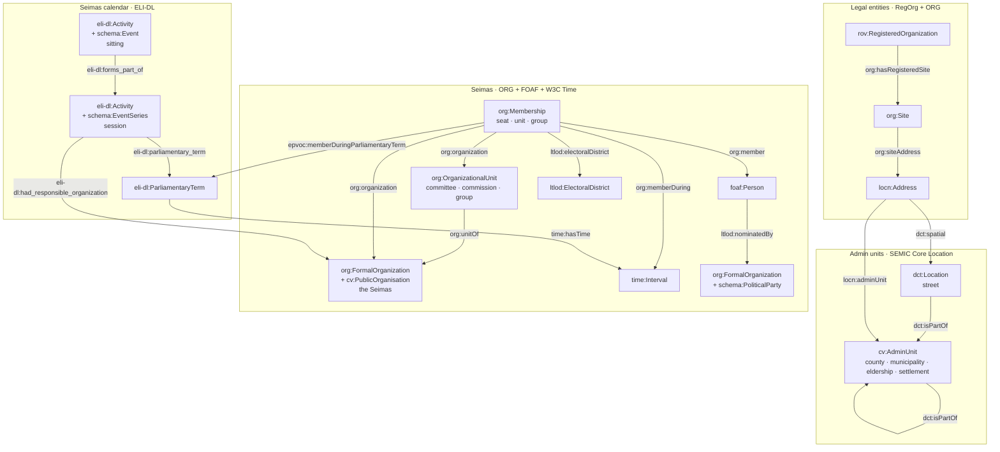

# Ontology & taxonomy notes

Vocabulary strategy: **W3C specs first → domain-specific third-party vocabularies (EU SEMIC, OP authority tables, FOAF) → schema.org as the shallow-but-wide general fallback → custom last.** (Membership validity therefore stays on W3C Time intervals, not schema:startDate/endDate.)

The per-domain property/datatype/cardinality constraints implied by these choices are formalized as SHACL shapes in `etl/shapes/` (executed in the validate stage and in CI).

## Overview

The main classes per domain and the links between them. Literal attributes, the `dh:Item`
documents that wrap every entity, and the two link targets every domain shares are left out
(they follow the diagram).

Classifications point at **SKOS** concepts (`skos:Concept`, one scheme per taxonomy):
`cv:level`/`dct:type` on admin units and streets, `rov:companyType`/`rov:orgStatus` on legal
entities, `dct:type` on Seimas units, `org:role` on memberships, `eli-dl:had_activity_type` on
sessions and sittings. Admin units and persons are aligned to **Wikidata** with `owl:sameAs`
(in the per-domain `alignments.trig`).

Sittings also carry `eli-dl:parliamentary_term` and `eli-dl:had_responsible_organization`
(drawn on sessions only). `cv:level` points at the EU ATU-type
authority table except for settlements. Each `time:Interval` has `time:hasBeginning` /
`time:hasEnd` → `time:Instant`; an interval with no end is the current state.

## Choices made

| Domain | Vocabulary | Notes |
|---|---|---|
| Admin units | SEMIC **Core Location 2.1.1**: `cv:AdminUnit`, `cv:level` (`cv:` = `http://data.europa.eu/m8g/`) | `cv:level` points at the EU **ATU-type** authority table (`LTU_APS`, `LTU_MSV`, `LTU_RSV`, `LTU_SV`, `LTU_SEN`) exactly as the CLV spec recommends. Settlements are typed `cv:AdminUnit` pragmatically with a custom level concept (`taxonomies/admin-unit-levels/gyvenamoji-vietove`) — they are territorial rather than administrative units, and ATU-type has no concept for them. |
| Streets | `dct:Location` + `dct:type` → street-type concept | No EU/W3C thoroughfare class; `locn:thoroughfare` is a literal-valued address property. |
| Legal entities | W3C/SEMIC **RegOrg**: `rov:RegisteredOrganization` (⊑ `org:FormalOrganization`), `rov:legalName`, `rov:companyType`, `rov:orgStatus`; registration period as W3C **Time** `time:hasTime` → `time:Interval` (`#registration`) → `#registered` / `#deregistered` `time:Instant` → `dct:temporal` calendar day | Form/status ranges are our SKOS concepts generated from the JAR classifiers. The whole register (incl. deregistered entities, whose IRIs procurement/payroll/other sources reference) — one mapping for the committed budget institutions and the bulk rest. `schema:foundingDate`/`dissolutionDate` literals stay beside the interval (sorting, charts); the interval follows the same shape as Seimas terms (`time:hasTime`), so the day page's `:DayRegistrations`/`:DayDeregistrations` views reach the entity through the instant. |
| Registered office (legal entities) | W3C **ORG** + SEMIC **Core Location**: `org:hasRegisteredSite` → `org:Site` → `org:siteAddress` → `locn:Address` (`locn:adminUnit` ×2, `locn:addressId`, `locn:postCode`) + DCMI `dct:spatial` → street | Office resolved JAR `Buveine` → AR `Pastatas` on `aob_kodas`, or AR `Patalpa` → its `Pastatas` when the office is a premises address (half of them; see backlog note). `locn:adminUnit` is IRI-valued here (CLV's `adminUnitL1/L2` are literal name fields — mild documented extension) and points at both the municipality and the settlement; its `rdfs:range cv:AdminUnit` in `ns.ttl` also targets the "organizations registered here" 1:N view. The street is `dct:spatial` (range `dct:Location`, the streets' class): LOCN has only the literal `locn:thoroughfare`, and `locn:adminUnit` would misclassify a street as an admin unit. `locn:addressId` carries the AR address-object code (`aob_kodas`) — a join key for any address-keyed source. |
| Electoral districts | custom **`ltlod:ElectoralDistrict`** + `ltlod:electoralDistrict` | No W3C/EU term for a parliamentary constituency; apygardos parsed from the members feed into their own `constituencies/` container. Not admin units. Cascade-justified (custom last), mirrors `ltlod:nominatedBy`. |
| Org structure, positions, memberships | W3C **ORG**: `org:OrganizationalUnit`, `org:unitOf`, `org:Membership`, `org:member`, `org:organization`, `org:role`, `org:memberDuring` | Change over time = n-ary `org:Membership` + `time:Interval` (`time:hasBeginning/hasEnd` → `time:Instant` → `time:inXSDDate`). **No reification, no RDF-star.** Current state = memberships without `time:hasEnd`. |
| Persons | `foaf:Person`, `foaf:givenName/familyName/name/mbox/gender/phone` | Core Person 2.0 compatible (it reuses foaf); revisit `person:` terms if birth data is added later. Phones are normalized to `tel:+370…` E.164 URIs in the mapping (bare 7-digit values are Vilnius landlines, area code 5) — reuse that BIND pattern in any future mapping with phone numbers. |
| Taxonomies | **SKOS** | Concept-per-graph; schemes are containers. |
| Parties | `org:FormalOrganization` + `schema:PoliticalParty` | No W3C/SEMIC political-party class exists; schema.org (general-fallback cascade level) has one. The extra type also lets LinkedDataHub target party-only views (`ldh:inverseView` matches instance types against a property's declared `rdfs:range` — exact match, no subsumption). |
| The Seimas | `org:FormalOrganization` + `cv:PublicOrganisation` (SEMIC **CPOV**) | Distinguishes the parliament from parties and legal entities, which share `org:FormalOrganization`; used to target Seimas-only LinkedDataHub views (members, units). |
| Seimas calendar (terms, sessions, sittings) | EU **ELI-DL** (ELI Draft Legislation ontology): `eli-dl:ParliamentaryTerm`, `eli-dl:Activity`, `eli-dl:had_activity_type` → `eli-dl:ActivityType` concepts, `eli-dl:parliamentary_term`, `eli-dl:forms_part_of`, `eli-dl:had_responsible_organization`, `eli-dl:recorded_in_a_realization_of`; tenure → term via EP **EPVOC** `epvoc:memberDuringParliamentaryTerm` (domain `org:Membership`, range `eli-dl:ParliamentaryTerm`) | Sessions and sittings are both `eli-dl:Activity`; the second type (`schema:EventSeries` session, `schema:Event` sitting) only discriminates them for LinkedDataHub views (exact-type `rdfs:range` match), as `schema:PoliticalParty` does for parties. Activity dates use ELI-DL's own `activity_date` / `activity_start_date` / `activity_end_date` directly on the activity rather than a `time:Interval`: LDH view sort/filter columns must hang off the projected entity. Sitting times are Vilnius local time from the source, emitted as `xsd:dateTime` without a zone offset. `eli-dl:ParliamentaryTerm` has no date properties, so a term's period is a W3C Time interval (`time:hasTime`). Session → term and sitting → session deliberately avoid `dct:isPartOf`: LDH attaches `ldh:inverseView`s per property, and `dct:isPartOf` already carries the admin-unit `:SubUnits` view. |
| Seimas plenary votes | EU **ELI-DL**: `eli-dl:Vote` (a `Decision`, itself an `Activity`), `eli-dl:decision_method` → `eli-dl:DecisionMethod` concepts, `eli-dl:number_of_attendees` / `number_of_votes_favor` / `_against` / `_abstention`, `eli-dl:had_voter_favor` / `_against` / `_abstention` → `foaf:Person`, the agenda item as `eli-dl:activity_label`; vote → sitting via **schema.org** `schema:superEvent` | ELI-DL has the whole roll-call model, so no custom terms. The sitting link is `schema:superEvent`, not `eli-dl:forms_part_of`: LDH attaches `ldh:inverseView`s per property and `forms_part_of` already carries session → sittings. Counts and voters only for open votes (`Atviras`): consensus decisions report 0/0/0 with no individual choices, secret ballots (`Slaptas`) have none either, and alternative votes reuse the Už/Prieš columns for option A/B, which `had_voter_favor`/`_against` would misstate. Turnout (`number_of_attendees` = members who voted) is kept whenever someone voted. The agenda item is not (yet) its own entity; its title is the vote's `activity_label` and, with the stage, part of `dct:title`. The source's per-vote comment ("individual electronic results do not match the protocol totals") is boilerplate on every vote, matching or not, and is dropped. |
| Seimas bills and agenda items | EU **ELI-DL**: bill = `eli-dl:DraftLegislationWork` (`dct:identifier` = registration number, `eli-dl:legislative_process_work_date` = registration day, `eli-dl:legislative_process_work_creator` → `foaf:Person` initiators); agenda item = `eli-dl:Activity` with `eli-dl:involved_work` → bill(s), `eli-dl:occured_at_stage` → `eli-dl:ProcessStage` concepts, `eli-dl:had_participant_person` → speakers, `eli-dl:activity_order`; item → sitting and vote → item via **schema.org** `schema:superEvent`; the e-seimas document of the planned agenda as `rdfs:seeAlso` | ELI-DL again covers the whole model, no custom terms. A bill is the *abstract* work (ELI-DL allows either reading): the registration number without its revision suffix, so every revision `(2)`, `(3)` cited by the agenda lands on one bill; the revision documents themselves are e-seimas pages (`rdfs:seeAlso` on the item that considered them), not entities. An agenda item is one consideration at one sitting (the source's `svarstomo_klausimo_id`): the same bill resumed or at its next stage is another item — that is the unit the Seimas votes and speaks on. Items reuse `schema:superEvent` → sitting, the property votes already use: both views on it (`:SittingVotes`, `:SittingAgendaItems`) belong on the sitting page, and votes now also point at their item with the same property, so the item page reuses `:SittingVotes` (its range gains `eli-dl:Activity`, the items' only type). Items are not `schema:Event` — that type carries the sitting views (`:DaySittings`, …). Stage is a concept, not a literal, so it can be a facet. Initiators only for bills members initiated: the open-data feed lists members' bills; the Government's and committees' bills are known only from the agenda, without initiator. Vote → bill goes through the item (no `eli-dl:decided_on_a_realization_of`): an item's votes include procedural ones (postponement, amendments), which a direct decision link would misstate as votes on the bill itself. |
| Calendar (days, months, years) | W3C **Time**: `time:DateTimeInterval` with a `time:DateTimeDescription` (`#description`: `time:unitType` `unitYear`/`unitMonth`/`unitDay`, `time:year` `xsd:gYear`, `time:month` `xsd:gMonth`, `time:day` `xsd:gDay`, `time:dayOfWeek`), day → month → year via `time:intervalIn`; **DCMI** `dct:PeriodOfTime` + `dct:temporal` for entity → day | Gives a day a URI so its page can list what happened (`:DaySittings`, `:DayVotes`) and so external data can link to it — a date literal can't carry a view. `time:intervalIn` (not `intervalDuring`) because the first and last day of a month *start*/*finish* it. Literal dates stay (`eli-dl:activity_date` etc.): sorting and range queries need them. `dct:temporal`'s range `dct:PeriodOfTime` is the type the day views target; years and months are typed the same and the empty views stay hidden. Linked: sittings and votes directly; terms, sessions and memberships (seats, unit positions, parliamentary groups) through their start/end `time:Instant`s, each of which gets `dct:temporal` → its day (an instant lies within that day — accurate, and uniform with sittings). Sessions keep their ELI-DL literal dates (view sort keys) and additionally get a `time:hasTime` interval like terms, so they have instants to link. The day page's views (`:DayTerms`, `:DaySessions`, `:DayMembershipsBegan` / `Ended`) reach the term/session/person through the instant. Legal entities link their registration / deregistration instants the same way (the calendar starts on 1977-01-01 to cover the earliest JAR registration, 1977-11-11; the Seimas data starts in 1990). Admin-unit dates are not linked (`validFrom` is mostly register-load noise). **Public holidays**: SKOS concepts in `taxonomies/holidays/`; a day that was a public holiday gets `dct:type` → the concept (as streets → street type); a day can have two (May 1 on Mother's Day). Validity periods follow the acts' effective dates (Švenčių dienų įstatymas I-712 of 1990 and its amendments, Darbo kodeksas 2002 art. 162 / 2016 art. 123), with the legal basis in each concept's `skos:scopeNote`. Soviet-era holidays still in force in early 1990 (Mar 8, May 1–2, May 9) and Feb 16 / Easter 1990 are left out because their status is unconfirmed. |
| Asset declarations (VMI FR0001) | custom **`ltlod:AssetDeclaration`** + `ltlod:declarant` (⊑ `dct:creator`) + `ltlod:declaredValue` → `schema:MonetaryAmount` (`schema:value`, `schema:currency`, `dct:type` → asset-categories concept); `dct:temporal` → the calendar **year**; `dct:type` → declarant-groups concept; `dct:issued` / `dct:modified` filing dates | No W3C/EU/schema.org class for an official's asset declaration (the 2012 `dis:` vocabulary is unmaintained). `ltlod:declarant` specializes `dct:creator` instead of reusing it because LDH attaches views per property and range, and `dct:creator` is used loosely (LDH's own documents carry it); the data carries only the subproperty. Amounts are kept as published — `LTL` for reporting years ≤ 2014, `EUR` since — never converted. Filing dates stay literals (no calendar-day link): `dct:temporal` already carries the reporting year. |
| Public officials (the President, the Government, mayors, MEPs) | W3C **ORG** `org:Membership` (`org:member`, `org:organization`, `org:role` → position-types concept, `org:memberDuring` → `time:Interval`), the same model as Seimas positions; `foaf:Person`; `owl:sameAs` → Wikidata item / EP person (`https://data.europarl.europa.eu/person/{id}`) | One office = one membership, keyed by position and start date. Organizations: the Government, the President (the constitutional institution) and the European Parliament are `org:FormalOrganization` + `cv:PublicOrganisation` scaffolding documents. A mayor's organization is the **municipality itself** (`cv:AdminUnit`): a *savivaldybė* is both the territory and its self-governing community (Constitution art. 119), there is no separate municipality-as-organization entity in the data, and the JAR legal entities (the council, the administration) are not what a mayor is a member of. Hence `org:organization`'s `rdfs:range` in `ns.ttl` adds `cv:AdminUnit` (view targeting, not strict OWL). No `epvoc:memberDuringParliamentaryTerm` on MEP mandates although EPVOC is the EP's own vocabulary: queries and views read that property as "Seimas seat"; the EP term is in the fragment key instead. EPVOC's richer EP model (`epvoc:` organisations, national parties) is a possible follow-up. WDQS returns P39 start/end qualifiers as plain dateTimes, without their precision, so a year-precision date reads as 1 January. Offices before 1990-03-11 (interwar Presidents and ministers, which Wikidata files under the same positions) and undated statements are dropped. |
| Validity dates | `schema:validFrom` / `schema:validThrough` (admin units), `schema:foundingDate` / `schema:dissolutionDate` (legal entities) | No EU RDF term for registry lifecycle dates (INSPIRE models them as `beginLifespanVersion` in GML only). |

## Legacy vocabulary disposition (2012 datasets)

- `ltlod.ttl` (in the removed Graphity webapp) was a **Graphity sitemap
  ontology** (URL routing), not a domain ontology. The whole proto-LinkedDataHub
  webapp (`src/`, `pom.xml`) has been removed — LinkedDataHub supersedes that
  layer entirely; everything remains in git history.
- `dis:` (semantic-web.dk disclosures) and `pc:` (purl.org/procurement) are
  unmaintained. When declarations/procurement domains are refreshed:
  procurement → EU **ePO** (`http://data.europa.eu/a4g/ontology#`);
  declarations → small custom vocabulary under `http://linkeddata.lt/ns#` *(done for
  property declarations: `ltlod:AssetDeclaration`, see the table above; VTEK interest
  declarations are still open)*.
- `owl:sameAs` → DBpedia links in the 2012 data remain valid where entities are
  re-minted with the same keys; the new alignment target is **Wikidata**.
- `translations.rdf` (the webapp's XSLT label dictionary) is gone with it —
  labels now live in the data itself (`@lt` + `@en`).

## Known modeling debts / improvement backlog

- **Gendered position concepts**: Seimas position strings are gendered
  ("Komiteto narys"/"Komiteto narė" become two concepts). Add a
  gender-neutral concept layer linked via `skos:related`/`skos:broader`, or
  normalize during mapping.
- **Party identity**: parties are keyed by name slug until matched to JAR
  codes / VRK identifiers; then add `dct:identifier` + `owl:sameAs`.
- **Person identity across sources**: `persons/{asmens_id}/` is
  Seimas-scoped. When VRK/declaration sources are added, cross-source
  identity via Wikidata QIDs and shared natural keys. VMI declarations carry no
  key at all, so `ltlod-declarations` matches by exact name + Seimas seat years
  (+ a curated `aliases.csv`); declarants who never held a seat (most mayors,
  vice-ministers) stay unpublished until persons are minted beyond the Seimas.
- **Registered office → municipality, settlement, street** *(done)*: legal entities
  link to their registered office via the SEMIC chain `org:hasRegisteredSite →
  org:Site → org:siteAddress → locn:Address`, resolved deterministically from JAR
  `buveines/Buveine` (`juridinis_asmuo.ja_kodas → adresas.aob_kodas`, one current
  office per registered entity) joined on `aob_kodas` to AR `pastatas/Pastatas`
  (`→ savivaldybe.sav_kodas`, `gyvenamoji_vietove.gyv_kodas`, `gatve.gat_kodas`,
  `pasto_kodas`) — directly for a building address, through AR `patalpa/Patalpa`
  (premises `aob_kodas → pastatas.aob_kodas`) for a premises address. The join runs
  in awk before CSV2RDF (`etl/legal-entities/Makefile`, `offices.csv`): 95% of the
  offices resolve, the rest have no address code in Buveine. `locn:adminUnit` →
  `admin-units/{sav_kodas}/#this` and `admin-units/{gyv_kodas}/#this`, `dct:spatial`
  → `streets/{gat_kodas}/#this` (the last two point into the gitignored bulk layer),
  `locn:addressId` and `locn:postCode` literals. Postcode is an attribute, **not** a
  join key (postcode→municipality is not guaranteed 1:1; `aob_kodas → sav_kodas` is
  exact). Deregistered entities have no office (Buveine lists registered ones only).
  Still deferred: full AR `adresai`/`adresotaskas` address entities (a building
  page that lists its occupants), office history.
- **Admin-unit coordinates** *(done)*: every admin-unit level carries a WGS84
  representative point as `geo:lat`/`geo:long` (WGS84 Basic Geo,
  `http://www.w3.org/2003/01/geo/wgs84_pos#`, `xsd:decimal`), computed by
  `ltlod-geo` from the AR spatial models (`gra{apskritis,savivaldybe,seniunija,
  gyvenamojivietove}`, LKS-94/EPSG:3346 polygons → `shapely.representative_point`
  → reproject to EPSG:4326). Emitted to `*-geo.trig` (same graph names, merged on
  load — the `alignments.trig` convention). **Why `geo:lat`/`geo:long`, not
  GeoSPARQL/`locn:Geometry`**: (a) it is the exact pair LinkedDataHub's map reader
  keys on (`RDFXML2GeoJSON.xsl` matches `[geo:lat][geo:long]`), so it unlocks
  `ac:MapMode`; (b) W3C-first per the vocab cascade; (c) AutoGraph precedent.
- **Admin-unit boundaries** *(done, coarse levels)*: counties/municipalities/
  elderships also carry their polygon as **GeoSPARQL** `gsp:asWKT`
  (`http://www.opengis.net/ont/geosparql#`, datatype `gsp:wktLiteral`) so LDH's
  `map.xsl` draws the shape (a `wktLiteral` is what it reads; WGS84 Basic Geo has
  no WKT property). Placed **directly on `#this`** (not via `geo:hasGeometry`) so
  the OpenLayers feature id is the admin-unit URI → the polygon is clickable and
  its info-window resolves to the unit. The WKT is **bare WGS84 lon-lat** (no
  CRS-URI prefix — OpenLayers can't parse one) and **Douglas–Peucker simplified**
  (`ltlod-geo --simplify`, ~50 m in source metres): LDH does no client-side
  simplification and the raw polygons are ~160 MB, so we simplify for display
  (~95–99 % fewer vertices, identical at map zoom). Settlements stay **point-only**
  (20 880 polygons are too heavy for the client). Full-resolution geometries,
  `adresotaskas` address points, and per-feature topology (shared borders) remain
  future work.
- **NUTS/LAU exactMatch** *(counties done)*: counties carry `skos:exactMatch` →
  `http://data.europa.eu/nuts/code/LT0xx` (NUTS3, from Wikidata P605) in
  `admin-units/alignments.trig`. Municipalities are LAU (no P605) and inherit
  NUTS3 through their county; a direct municipality → LAU code link (Wikidata
  P782) is still open.
- **Seimas constituency** *(done)*: single-member electoral districts (apygardos)
  are parsed from `išrinkimo_būdas` into a `constituencies/{kadencijos_id}-{nr}/`
  container (`ltlod:ElectoralDistrict`), and the single-member seat (`org:Membership`
  tenure) carries `ltlod:electoralDistrict`. Districts are term-scoped because they
  are redrawn every election — the same number names a different district in
  another term. Party-list seats ("Pagal sąrašą", and the "Vyriausioji rinkimų
  komisija" / "Daugiamandatėje" Nr. 100 pseudo-district of older terms) have none. An apygarda is not an admin unit (own container, no `dct:isPartOf`
  into `admin-units/`). No clean online apygardos table exists (VRK's
  get.data.gov.lt `Apygarda` is municipal-election granularity), so the district
  is parsed from the members-feed string.
