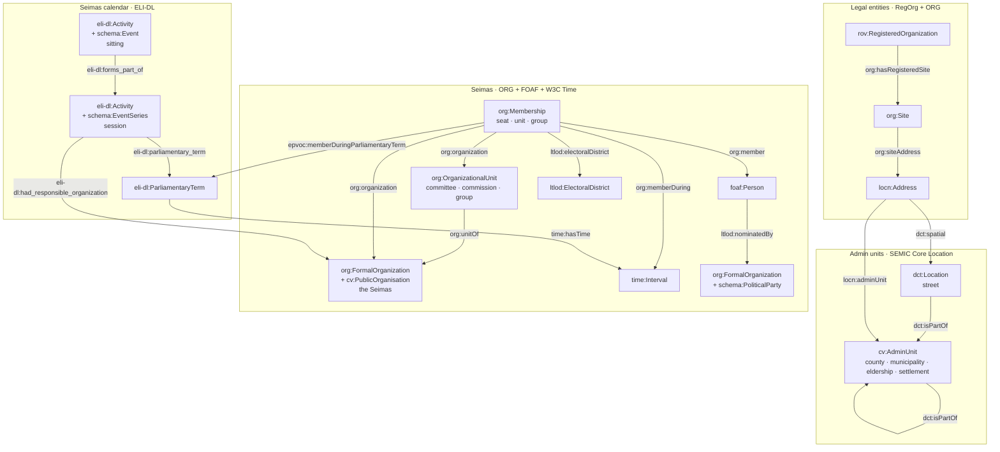

# Ontology & taxonomy notes

Vocabulary strategy: **W3C specs first → domain-specific third-party vocabularies (EU SEMIC, OP authority tables, FOAF) → schema.org as the shallow-but-wide general fallback → custom last.** (Membership validity therefore stays on W3C Time intervals, not schema:startDate/endDate.)

The per-domain property/datatype/cardinality constraints implied by these choices are formalized as SHACL shapes in `etl/shapes/` (executed in the validate stage and in CI).

## Overview

The main classes per domain and the links between them. Literal attributes, the `dh:Item`
documents that wrap every entity, and the two link targets every domain shares are left out
(they follow the diagram).

Classifications point at **SKOS** concepts (`skos:Concept`, one scheme per taxonomy):
`cv:level`/`dct:type` on admin units and streets, `rov:companyType`/`rov:orgStatus` on legal
entities, `dct:type` on Seimas units, `org:role` on memberships, `eli-dl:had_activity_type` on
sessions and sittings. Admin units and persons are aligned to **Wikidata** with `owl:sameAs`
(in the per-domain `alignments.trig`).

Sittings also carry `eli-dl:parliamentary_term` and `eli-dl:had_responsible_organization`
(drawn on sessions only). `cv:level` points at the EU ATU-type
authority table except for settlements. Each `time:Interval` has `time:hasBeginning` /
`time:hasEnd` → `time:Instant`; an interval with no end is the current state.

## Choices made

| Domain | Vocabulary | Notes |
|---|---|---|
| Admin units | SEMIC **Core Location 2.1.1**: `cv:AdminUnit`, `cv:level` (`cv:` = `http://data.europa.eu/m8g/`) | `cv:level` points at the EU **ATU-type** authority table (`LTU_APS`, `LTU_MSV`, `LTU_RSV`, `LTU_SV`, `LTU_SEN`) exactly as the CLV spec recommends. Settlements are typed `cv:AdminUnit` pragmatically with a custom level concept (`taxonomies/admin-unit-levels/gyvenamoji-vietove`) — they are territorial rather than administrative units, and ATU-type has no concept for them. |
| Streets | `dct:Location` + `dct:type` → street-type concept | No EU/W3C thoroughfare class; `locn:thoroughfare` is a literal-valued address property. |
| Legal entities | W3C/SEMIC **RegOrg**: `rov:RegisteredOrganization` (⊑ `org:FormalOrganization`), `rov:legalName`, `rov:companyType`, `rov:orgStatus`; registration period as W3C **Time** `time:hasTime` → `time:Interval` (`#registration`) → `#registered` / `#deregistered` `time:Instant` → `dct:temporal` calendar day | Form/status ranges are our SKOS concepts generated from the JAR classifiers. The whole register (incl. deregistered entities, whose IRIs procurement/payroll/other sources reference) — one mapping for the committed budget institutions and the bulk rest. `schema:foundingDate`/`dissolutionDate` literals stay beside the interval (sorting, charts); the interval follows the same shape as Seimas terms (`time:hasTime`), so the day page's `:DayRegistrations`/`:DayDeregistrations` views reach the entity through the instant. |
| Registered office (legal entities) | W3C **ORG** + SEMIC **Core Location**: `org:hasRegisteredSite` → `org:Site` → `org:siteAddress` → `locn:Address` (`locn:adminUnit` ×2, `locn:addressId`, `locn:postCode`) + DCMI `dct:spatial` → street | Office resolved JAR `Buveine` → AR `Pastatas` on `aob_kodas`, or AR `Patalpa` → its `Pastatas` when the office is a premises address (half of them; see backlog note). `locn:adminUnit` is IRI-valued here (CLV's `adminUnitL1/L2` are literal name fields — mild documented extension) and points at both the municipality and the settlement; its `rdfs:range cv:AdminUnit` in `ns.ttl` also targets the "organizations registered here" 1:N view. The street is `dct:spatial` (range `dct:Location`, the streets' class): LOCN has only the literal `locn:thoroughfare`, and `locn:adminUnit` would misclassify a street as an admin unit. `locn:addressId` carries the AR address-object code (`aob_kodas`) — a join key for any address-keyed source. |
| Electoral districts | custom **`ltlod:ElectoralDistrict`** + `ltlod:electoralDistrict` | No W3C/EU term for a parliamentary constituency; apygardos parsed from the members feed into their own `constituencies/` container. Not admin units. Cascade-justified (custom last), mirrors `ltlod:nominatedBy`. |
| Org structure, positions, memberships | W3C **ORG**: `org:OrganizationalUnit`, `org:unitOf`, `org:Membership`, `org:member`, `org:organization`, `org:role`, `org:memberDuring` | Change over time = n-ary `org:Membership` + `time:Interval` (`time:hasBeginning/hasEnd` → `time:Instant` → `time:inXSDDate`). **No reification, no RDF-star.** Current state = memberships without `time:hasEnd`. |
| Persons | `foaf:Person`, `foaf:givenName/familyName/name/mbox/gender/phone`; `schema:deathDate` (Wikidata P570, in `alignments.trig`) | Core Person 2.0 compatible (it reuses foaf); revisit `person:` terms if birth data is added later. The death date is the one biographical date so far: schema.org fallback (`schema:deathDate`, an `xsd:date`), merged in with the `owl:sameAs` alignment, not from the LRS feed; the name matchers use it as a lifetime guard. Phones are normalized to `tel:+370…` E.164 URIs in the mapping (bare 7-digit values are Vilnius landlines, area code 5) — reuse that BIND pattern in any future mapping with phone numbers. |
| Taxonomies | **SKOS** | Concept-per-graph; schemes are containers. |
| Parties | `org:FormalOrganization` + `schema:PoliticalParty` | No W3C/SEMIC political-party class exists; schema.org (general-fallback cascade level) has one. The extra type also lets LinkedDataHub target party-only views (`ldh:inverseView` matches instance types against a property's declared `rdfs:range` — exact match, no subsumption). |
| The Seimas | `org:FormalOrganization` + `cv:PublicOrganisation` (SEMIC **CPOV**) | Distinguishes the parliament from parties and legal entities, which share `org:FormalOrganization`; used to target Seimas-only LinkedDataHub views (members, units). |
| Seimas calendar (terms, sessions, sittings) | EU **ELI-DL** (ELI Draft Legislation ontology): `eli-dl:ParliamentaryTerm`, `eli-dl:Activity`, `eli-dl:had_activity_type` → `eli-dl:ActivityType` concepts, `eli-dl:parliamentary_term`, `eli-dl:forms_part_of`, `eli-dl:had_responsible_organization`, `eli-dl:recorded_in_a_realization_of` (protocol, stenogram and the YouTube recordings, `schema:VideoObject`); tenure → term via EP **EPVOC** `epvoc:memberDuringParliamentaryTerm` (domain `org:Membership`, range `eli-dl:ParliamentaryTerm`) | Sessions and sittings are both `eli-dl:Activity`; the second type (`schema:EventSeries` session, `schema:Event` sitting) only discriminates them for LinkedDataHub views (exact-type `rdfs:range` match), as `schema:PoliticalParty` does for parties. Activity dates use ELI-DL's own `activity_date` / `activity_start_date` / `activity_end_date` directly on the activity rather than a `time:Interval`: LDH view sort/filter columns must hang off the projected entity. Sitting times are Vilnius local time from the source, emitted as `xsd:dateTime` without a zone offset. `eli-dl:ParliamentaryTerm` has no date properties, so a term's period is a W3C Time interval (`time:hasTime`). Session → term and sitting → session deliberately avoid `dct:isPartOf`: LDH attaches `ldh:inverseView`s per property, and `dct:isPartOf` already carries the admin-unit `:SubUnits` view. |
| Seimas plenary votes | EU **ELI-DL**: `eli-dl:Vote` (a `Decision`, itself an `Activity`), `eli-dl:decision_method` → `eli-dl:DecisionMethod` concepts, `eli-dl:number_of_attendees` / `number_of_votes_favor` / `_against` / `_abstention`, `eli-dl:had_voter_favor` / `_against` / `_abstention` → `foaf:Person`, the agenda item as `eli-dl:activity_label`; vote → sitting via **schema.org** `schema:superEvent` | ELI-DL has the whole roll-call model, so no custom terms. The sitting link is `schema:superEvent`, not `eli-dl:forms_part_of`: LDH attaches `ldh:inverseView`s per property and `forms_part_of` already carries session → sittings. Counts and voters only for open votes (`Atviras`): consensus decisions report 0/0/0 with no individual choices, secret ballots (`Slaptas`) have none either, and alternative votes reuse the Už/Prieš columns for option A/B, which `had_voter_favor`/`_against` would misstate. Turnout (`number_of_attendees` = members who voted) is kept whenever someone voted. The agenda item is not (yet) its own entity; its title is the vote's `activity_label` and, with the stage, part of `dct:title`. The source's per-vote comment ("individual electronic results do not match the protocol totals") is boilerplate on every vote, matching or not, and is dropped. |
| Seimas bills and agenda items | EU **ELI-DL**: bill = `eli-dl:DraftLegislationWork` (`dct:identifier` = registration number, `eli-dl:legislative_process_work_date` = registration day, `eli-dl:legislative_process_work_creator` → `foaf:Person` initiators); agenda item = `eli-dl:Activity` with `eli-dl:involved_work` → bill(s), `eli-dl:occured_at_stage` → `eli-dl:ProcessStage` concepts, `eli-dl:had_participant_person` → speakers, `eli-dl:activity_order`; item → sitting and vote → item via **schema.org** `schema:superEvent`; the e-seimas document of the planned agenda as `rdfs:seeAlso` | ELI-DL again covers the whole model, no custom terms. A bill is the *abstract* work (ELI-DL allows either reading): the registration number without its revision suffix, so every revision `(2)`, `(3)` cited by the agenda lands on one bill; the revision documents themselves are e-seimas pages (`rdfs:seeAlso` on the item that considered them), not entities. An agenda item is one consideration at one sitting (the source's `svarstomo_klausimo_id`): the same bill resumed or at its next stage is another item — that is the unit the Seimas votes and speaks on. Items reuse `schema:superEvent` → sitting, the property votes already use: both views on it (`:SittingVotes`, `:SittingAgendaItems`) belong on the sitting page, and votes now also point at their item with the same property, so the item page reuses `:SittingVotes` (its range gains `eli-dl:Activity`, the items' only type). Items are not `schema:Event` — that type carries the sitting views (`:DaySittings`, …). Stage is a concept, not a literal, so it can be a facet. Initiators only for bills members initiated: the open-data feed lists members' bills; the Government's and committees' bills are known only from the agenda, without initiator. Vote → bill goes through the item (no `eli-dl:decided_on_a_realization_of`): an item's votes include procedural ones (postponement, amendments), which a direct decision link would misstate as votes on the bill itself. |
| Calendar (days, months, years) | W3C **Time**: `time:DateTimeInterval` with a `time:DateTimeDescription` (`#description`: `time:unitType` `unitYear`/`unitMonth`/`unitDay`, `time:year` `xsd:gYear`, `time:month` `xsd:gMonth`, `time:day` `xsd:gDay`, `time:dayOfWeek`), day → month → year via `time:intervalIn`; **DCMI** `dct:PeriodOfTime` + `dct:temporal` for entity → day | Gives a day a URI so its page can list what happened (`:DaySittings`, `:DayVotes`) and so external data can link to it — a date literal can't carry a view. `time:intervalIn` (not `intervalDuring`) because the first and last day of a month *start*/*finish* it. Literal dates stay (`eli-dl:activity_date` etc.): sorting and range queries need them. `dct:temporal`'s range `dct:PeriodOfTime` is the type the day views target; years and months are typed the same and the empty views stay hidden. Linked: sittings and votes directly; terms, sessions and memberships (seats, unit positions, parliamentary groups) through their start/end `time:Instant`s, each of which gets `dct:temporal` → its day (an instant lies within that day — accurate, and uniform with sittings). Sessions keep their ELI-DL literal dates (view sort keys) and additionally get a `time:hasTime` interval like terms, so they have instants to link. The day page's views (`:DayTerms`, `:DaySessions`, `:DayMembershipsBegan` / `Ended`) reach the term/session/person through the instant. Legal entities link their registration / deregistration instants the same way (the calendar starts on 1977-01-01 to cover the earliest JAR registration, 1977-11-11; the Seimas data starts in 1990). Admin-unit dates are not linked (`validFrom` is mostly register-load noise). **Public holidays**: SKOS concepts in `taxonomies/holidays/`; a day that was a public holiday gets `dct:type` → the concept (as streets → street type); a day can have two (May 1 on Mother's Day). Validity periods follow the acts' effective dates (Švenčių dienų įstatymas I-712 of 1990 and its amendments, Darbo kodeksas 2002 art. 162 / 2016 art. 123), with the legal basis in each concept's `skos:scopeNote`. Soviet-era holidays still in force in early 1990 (Mar 8, May 1–2, May 9) and Feb 16 / Easter 1990 are left out because their status is unconfirmed. |
| Land acquisitions (NŽT applications) | custom **`ltlod:LandAcquisitionApplication`** with `ltlod:applicant` → `rov:RegisteredOrganization` (+ the published `ltlod:applicantCode` / `ltlod:applicantName` and `ltlod:applicantCheck` → applicant-checks concept), `dct:type` → land-purposes concept, `dct:date` + `dct:temporal` (submission day), `schema:location` → the municipality (`cv:AdminUnit`), areas `ltlod:appliedArea` / `ltlod:heldArea` / `ltlod:heldAreaAfter` (hectares, as published); `ltlod:decision` → `#decision` **`ltlod:LandAcquisitionDecision`** (`dct:type` → land-acquisition-decisions concept, its own day). Natural persons: W3C **Data Cube** — `qb:Observation`s of `qb:DataSet` `land-acquisitions/natural-persons/#this` with dimensions `sdmx-dimension:refArea` (municipality), `dct:temporal` (calendar **year**), `dct:type` (land purpose) and measures `ltlod:applicationCount`, `ltlod:consentCount`, `ltlod:refusalCount`, `ltlod:appliedArea`, `ltlod:consentedArea` | No W3C/EU/schema.org class for an application for an administrative consent (CPSV-AP models the public *service*, not a filed request; ePO is procurement-only). The municipality goes on `schema:location` (schema.org before custom) because `locn:adminUnit` and `dct:spatial` already carry other 1:N views, and LDH attaches views per property. The applicant link is withheld when the published name clearly disagrees with the code (`neatitinka`): the code is then most likely another party's (e.g. the State Tax Inspectorate's next to a private company), and linking would assert a purchase by the wrong legal entity; code and name stay as literals. `heldArea` is the area of the applied-for land purpose the applicant already holds, as NŽT records it with each application — not the applicant's total land. An application with consent is not a completed purchase. Natural persons are counted only (NŽT hashes their codes and names); a cell of fewer than 3 applications is suppressed. |
| Asset declarations (VMI FR0001) | custom **`ltlod:AssetDeclaration`** + `ltlod:declarant` (⊑ `dct:creator`) + `ltlod:declaredValue` → `schema:MonetaryAmount` (`schema:value`, `schema:currency`, `dct:type` → asset-categories concept); `dct:temporal` → the calendar **year**; `dct:type` → declarant-groups concept; `dct:issued` / `dct:modified` filing dates | No W3C/EU/schema.org class for an official's asset declaration (the 2012 `dis:` vocabulary is unmaintained). `ltlod:declarant` specializes `dct:creator` instead of reusing it because LDH attaches views per property and range, and `dct:creator` is used loosely (LDH's own documents carry it); the data carries only the subproperty. Amounts are kept as published — `LTL` for reporting years ≤ 2014, `EUR` since — never converted. Filing dates stay literals (no calendar-day link): `dct:temporal` already carries the reporting year. |
| Public officials (the President, the Government, mayors, MEPs) | W3C **ORG** `org:Membership` (`org:member`, `org:organization`, `org:role` → position-types concept, `org:memberDuring` → `time:Interval`), the same model as Seimas positions; `foaf:Person`; `owl:sameAs` → Wikidata item / EP person (`https://data.europarl.europa.eu/person/{id}`) | One office = one membership, keyed by position and start date. Organizations: the Government, the President (the constitutional institution) and the European Parliament are `org:FormalOrganization` + `cv:PublicOrganisation` scaffolding documents. A mayor's organization is the **municipality itself** (`cv:AdminUnit`): a *savivaldybė* is both the territory and its self-governing community (Constitution art. 119), there is no separate municipality-as-organization entity in the data, and the JAR legal entities (the council, the administration) are not what a mayor is a member of. Hence `org:organization`'s `rdfs:range` in `ns.ttl` adds `cv:AdminUnit` (view targeting, not strict OWL). No `epvoc:memberDuringParliamentaryTerm` on MEP mandates although EPVOC is the EP's own vocabulary: queries and views read that property as "Seimas seat"; the EP term is in the fragment key instead. EPVOC's richer EP model (`epvoc:` organisations, national parties) is a possible follow-up. WDQS returns P39 start/end qualifiers as plain dateTimes, without their precision, so a year-precision date reads as 1 January. Offices before 1990-03-11 (interwar Presidents and ministers, which Wikidata files under the same positions) and undated statements are dropped. |
| Seimas elections (VRK) | custom **`ltlod:Election`** / **`ltlod:ElectionRound`** (both ⊑ `schema:Event`; round → election `schema:superEvent`, `schema:startDate` + `dct:temporal` → calendar day), `ltlod:electedTerm` → `eli-dl:ParliamentaryTerm`; **`ltlod:ConstituencyContest`** (`ltlod:election`, `ltlod:constituency` → `ltlod:ElectoralDistrict`, `ltlod:decidedInRound`) with **`ltlod:ContestRound`** fragments (`ltlod:contest`, `ltlod:electionRound`, `ltlod:ballotsCast`, `ltlod:turnout`), **`ltlod:CandidateResult`** (`schema:name` as published, `ltlod:candidate` → `foaf:Person`, `ltlod:nominatedBy` → party, `ltlod:nominatorName`, `ltlod:votes`, `ltlod:voteShare`, `ltlod:rank`, `ltlod:elected`) and **`ltlod:PartyListResult`** (`ltlod:party`, `ltlod:listNumber`, votes, share) | No W3C/EU vocabulary models elections or results; schema.org has no election class (only `schema:Event`), Popolo was rejected (its namespace does not dereference). The RDF Data Cube was considered for the vote counts and rejected: every count belongs to one named candidate or list in one round, so plain n-ary result resources keep each row a linkable fragment of its contest document, which LDH can list in views. Shares are kept as VRK publishes them (percent of valid ballots), never recomputed. `ltlod:nominatedBy` is reused for the candidate's party (same meaning as on a seat); every other link that needs a 1:N view has its own property. A candidate who never held a Seimas seat is not minted as a person — the result keeps the published name only. |
| Political campaign finance (VRK) | custom **`ltlod:CampaignParticipant`** (`schema:name`, `dct:type` → participant-type concept, `ltlod:campaignName`, `ltlod:inElection` → `ltlod:Election`, `ltlod:campaignOf` → `foaf:Person` / `schema:PoliticalParty`, `ltlod:nominatedBy`, `ltlod:vrkCandidateId`, `ltlod:candidacy` → `ltlod:CandidateResult`); **`ltlod:CampaignDonation`** (legal-person income: `ltlod:recipient`, `ltlod:donor` → `rov:RegisteredOrganization`, `ltlod:donorName`, `ltlod:donorCode`, `dct:type` → funding-source concept, `ltlod:fundsForm`, `schema:value` + `schema:currency`, `dct:date` + `dct:temporal` → day); **`ltlod:CampaignExpense`** (legal-person provider: `ltlod:payer`, `ltlod:provider`, `ltlod:providerName`, `ltlod:providerCode`, `dct:type` → purpose concept, value, date); **`ltlod:CampaignIncomeTotal`** / **`ltlod:CampaignExpenseTotal`** (natural persons, aggregated: `ltlod:count`, `schema:value`) | No W3C/EU vocabulary covers political finance; EU **ePO** models procurement, not donations; schema.org has `MonetaryAmount` but no donation/expense class. Amounts follow the declarations pattern (`schema:value` + `schema:currency`, kept as published: VRK reports EUR, litas-era campaigns converted by VRK). The donor and provider link by bare JAR code, so they join procurement contractors with no lookup. Natural persons are aggregated (privacy: they are private individuals; the harvest already drops their identifiers). Funding sources, expense purposes and participant types are SKOS concepts keyed by VRK's codes, derived from the data like the decision methods. Every link needing a 1:N view has its own property (`ltlod:donor` / `ltlod:provider` on organisations, `ltlod:campaignOf` on persons and parties, `ltlod:recipient` / `ltlod:payer` on participants); `ltlod:nominatedBy` is reused for the candidate's nominating party. |
| Facilities (education, health care, heritage) | **schema.org** `schema:EducationalOrganization`, `schema:MedicalOrganization` (+ W3C **ORG** `org:Organization`, `org:subOrganizationOf` for school branches, `org:hasSite` → `org:Site` → `org:siteAddress` for licensed activity addresses), `schema:Permit` (licence: `dct:identifier`, `schema:validFrom`), `schema:LandmarksOrHistoricalBuildings` (KVR object; complex member → complex via `schema:containedInPlace`); location SEMIC **Core Location** `locn:address` → `locn:Address` → `locn:adminUnit` (IRI-valued, as for registered offices); `dct:type` → education-type / heritage-kind concepts, `dct:subject` → heritage valuable-property concepts; custom `ltlod:legalEntity`, `ltlod:licence`, `ltlod:protectionStatus`, `ltlod:significance` | No W3C/EU class for a school, a health-care provider or a heritage object (INSPIRE has GML-only *Protected sites*; CIDOC-CRM is a museum-object model) — schema.org is the cascade's general fallback. The facility → legal-entity link is its own property (not `owl:sameAs`: a school branch is not the legal entity; not `schema:parentOrganization`: the legal entity is not a *parent*). A facility's time on its register (ŠVIS registration / deregistration, KVR registration, licence issue) is a `time:Interval` via `time:hasTime` with `time:Instant`s → calendar day, per the calendar-link rule. KVR status-change dates are not modelled (a date without its prior status says little). Free-text KVR classification (`koplytstulpis`, `piliakalnis`, …, ~1 000 distinct values) stays a literal `schema:category`. ŠVIS coordinates come as LKS-94 `POINT (N E)` — reprojected to WGS84 `geo:lat`/`geo:long` in `ltlod-facilities` with the same axis-order care and bounds check as `ltlod-geo`. |
| Public procurement contracts (VPT CVP IS) | EU **ePO** (eProcurement Ontology, OP/SEMIC, `epo:` = `http://data.europa.eu/a4g/ontology#`): `epo:Contract`, `epo:hasContractConclusionDate`, `epo:hasContractValue` → `epo:MonetaryValue` (`epo:hasAmountValue`, `epo:hasCurrency` → OP **currency** table), `epo:hasPurpose` → `epo:Purpose` (`epo:hasMainClassification` → OP **CPV** URI), `epo:bindsBuyer` / `epo:bindsContractor` → `epo:Buyer` / `epo:Contractor` roles, `epo:playedBy` → the organisation; `dct:type` → OP **contract-nature** (`supplies`/`services`/`works`); `dct:temporal` → conclusion day | ePO is the EU's procurement vocabulary (used by TED's linked data) and dereferences; its role pattern is kept rather than shortcut, so a contract's parties stay typed by role and the same organisation can be buyer on one contract and contractor on another. `epo:hasContractNatureType` belongs to `epo:ContractTerm`, not the contract, so the nature is a plain `dct:type`. CPV URIs drop the check digit (`45233161`, as OP mints them). The source has no procedure type in this table (the Atn-1 procedure reports on get.data.gov.lt stop in May 2023), and its expiry dates reach 2055 (beyond the calendar) — both left out. Non-JAR organisations (foreign suppliers) are a described `org:Organization` fragment (`epo:hasLegalName`); natural-person contractors are pseudonymised in the source and get a role with no agent. Contract **amendments** (CVP IS form 2) are not contracts here: each restates the whole contract value under the original number (one road contract: 25 amendments in a year), so they are excluded at fetch time rather than modelled (ePO has `epo:amendsContract`, but the source gives no link to the amended contract's document id). |
| Private interests (VTEK PINREG) | W3C **ORG** `org:Membership` per declared tie (`org:member` declarant, `org:organization` legal entity, `org:role` → interest-roles concept typed `org:Role`, `org:memberDuring` → `time:Interval`); custom **`ltlod:InterestDeclaration`** (`ltlod:declarant`), `ltlod:declaredIn` (tie → declaration), `ltlod:interestOrganization` (⊑ `org:organization`), `ltlod:inPublicProcurement` | A tie (shareholder, board member, member, head…) is a role-bearing relation between a person and an organization over a period: exactly the n-ary ORG membership already used for Seimas positions, so ties land in the person's memberships table and their since/until in the calendar (instants, as for seats). Shareholding is not "membership" in the everyday sense, but ORG's `org:Membership` is defined as an n-ary relation with an `org:role` and is routinely used for it; the Beneficial Ownership Data Standard (Open Ownership) is JSON-only, with no maintained RDF form. No W3C/EU class for the declaration itself, hence `ltlod:`. The two subproperties exist only so LDH can attach views per property: `org:organization` already carries the Seimas member views, and a tie has no other link back to its declaration. The data carries both `org:organization` and `ltlod:interestOrganization` explicitly (no reasoner). Only the declarant's own ties are modelled; spouse/partner data, personal codes and birth dates are dropped at harvest. |
| Lobbying (VTEK SKAIDRIS) | custom **`ltlod:Lobbyist`** (⊑ `foaf:Agent`, plus `foaf:Organization`/`foaf:Person`), **`ltlod:LobbyingDeclaration`** (⊑ subclasses `TransparencyDeclaration` / `InfluenceDeclaration`), **`ltlod:LobbyingContact`**; `ltlod:agent` (⊑ `owl:sameAs`) → legal entity / person; `dct:subject` → lobbying-areas concept; `ltlod:draftAct` → Seimas bill (`eli-dl:DraftLegislationWork`); `ltlod:activityDate` + `dct:temporal` → day | No W3C, EU (SEMIC/ELI/ePO) or schema.org vocabulary covers lobbying; the EU Transparency Register publishes no RDF terms, so this is the `ltlod:` end of the cascade. PROV-O (`prov:Activity` + qualified associations for lobbyist/client/beneficiary) was considered, but client and beneficiary are free text in the source, with no agent to associate. `ltlod:agent` specializes `owl:sameAs` (as `ltlod:declarant` does `dct:creator`) so the lobbyist registration can show as a view on the company or person page without attaching a view to the ubiquitous `owl:sameAs`. Lobbied persons and institutions are fragments carrying the source text, with links only where the normalizer resolved them unambiguously (unique exact name; legal name; curated aliases); e-mail addresses are never emitted. The lobbying date (`executionDate`, stored by the app as UTC midnight of the Vilnius date) is converted to the Vilnius calendar date. |
| Match provenance (all name-based links to `persons/`) | custom **`ltlod:matchMethod`** → SKOS concept in `taxonomies/match-methods/` (`alias`, `exact-name`, `name-and-office`), stated on the node that carries the link (lobbying contact, lobbyist, declaration, candidate result, campaign participant, an official's office membership) | Considered W3C **PROV-O** (`prov:qualifiedDerivation` + a `prov:Derivation` node with `prov:hadActivity`/`prov:hadPlan`): it fits "W3C first", but needs an extra node per link to say one fact, and the project rules out reification/RDF-star. Almost every name-based link already sits on its own minted node, so one property with a SKOS value is enough, filterable in queries and visible in LDH. Code joins carry no method (exact by construction). |
| Employer statistics (Sodra) | W3C **Data Cube** (`qb:DataSet` + `qb:DataStructureDefinition`, `qb:Observation`) + **SDMX-RDF** `sdmx-dimension:refArea` (→ the municipality, AR `sav_kodas`); month dimension `dct:temporal` → the calendar **month**, plus a `dct:date` `xsd:gYearMonth` literal; custom **`ltlod:employer`** (dimension → `legal-entities/{ja_kodas}/#this`), latest-month measures **`ltlod:insuredCount`**, **`ltlod:averageWage`**, **`ltlod:contributions`** and window measures **`ltlod:monthsReported`**, **`ltlod:meanInsuredCount`**, **`ltlod:meanAverageWage`** (headcount-weighted), **`ltlod:totalContributions`** | **Default = one summary observation per employer** (the document's `#this`: its latest month in the 12-month window, the figures as published, plus the window aggregates over the months it reported) — ~1.9M quads, browsable, one row per employer. The full monthly series (~14M quads) is opt-in (`SODRA_CUBE=1`): `#{yyyy-mm}` observations of a second qb:DataSet (`#monthly`), an overlay merged into the same documents. Data Cube is the W3C vocabulary for this shape (values per employer × month), and qb/SDMX namespaces dereference; the summary stays a qb:Observation (of its own DSD) so both share dimensions and the latest-month measures. Measures must be literals on the observation, so schema.org's `numberOfEmployees` (→ `QuantitativeValue` node, no period) does not fit; no W3C/EU/SDMX measure exists for insured persons, wage or contributions, hence `ltlod:` (typed `qb:MeasureProperty` in `ns.ttl`; wage and contributions are EUR). `dct:temporal` (not `sdmx-dimension:refPeriod`) is the month dimension so observations join the calendar like every other dated entity and the month page gets its `:MonthEmployers` view (summary observations only: `ltlod:monthsReported`). Observations carry every dimension (Data Cube normalized form). Values are kept as Sodra publishes them; an unpublished value is an absent measure (Sodra suppresses the wage of small employers, so the window mean wage covers only the months it was published). The summary's municipality is the most recent one the employer reported in the window. |
| Legal-entity taxes (VMI) | W3C **Data Cube** (`qb:DataSet` + `qb:DataStructureDefinition`, `qb:Observation`) + **SDMX-RDF** `sdmx-dimension:refArea` (→ the registration municipality, AR `sav_kodas`); custom dimension **`ltlod:taxpayer`** (→ `legal-entities/{ja_kodas}/#this`); the arrears snapshot (`#this`) carries `dct:temporal` → the calendar **day** (+ `dct:date` `xsd:date`) and measures **`ltlod:arrears`**, **`ltlod:overdueArrears`**, **`ltlod:deferredArrears`**, **`ltlod:deferredOverdueArrears`** (EUR); taxes paid (`#paid-{yyyy}`) carry `dct:temporal` → the calendar **year** (+ `dct:date` `xsd:gYear`) and measure **`ltlod:taxesPaid`** (EUR) | The two VMI feeds (current arrears per entity; taxes paid per entity per year) are both observations keyed on the taxpayer, so Data Cube is the same fit as the Sodra employer figures, and the taxpayer document reuses the shape (`#this` the arrears snapshot — the document topic, present even for an entity that owes nothing but paid tax — plus one `#paid-{yyyy}` observation per reporting year). No W3C/EU/SDMX measure exists for tax arrears or taxes paid, hence `ltlod:` (typed `qb:MeasureProperty` in `ns.ttl`, all EUR). `ltlod:taxpayer` links by bare JAR code, so it joins procurement contractors, Sodra employers and campaign donors with no lookup; it dangles until the full JAR register is loaded. Amounts are kept as VMI publishes them; a measure absent (not zero) means VMI publishes no value. The calendar day (one publication date, tens of thousands of entities) and year (every taxpaying company) carry the `dct:temporal` link but get no calendar listing — neither population fits a calendar page's budget, unlike a day's procurement contracts. |
| Insolvency (AVNT bankruptcy / restructuring) | custom **`ltlod:InsolvencyProceeding`** (one per proceeding); `dct:type` → `taxonomies/insolvency-types/` (`bankrotas` / `restrukturizavimas`); **`ltlod:insolvent`** → `legal-entities/{imones_kodas}/#this` (+ `ltlod:companyCode`/`ltlod:companyName` literals); `sdmx-dimension:refArea` → the municipality; **`ltlod:court`** → `taxonomies/courts/` (5 apygardos teismai), **`ltlod:initiatedBy`** → `taxonomies/insolvency-initiators/`; lifecycle as W3C **Time** `time:hasTime` → `time:Interval` (`#period`) → `#start` / `#end` `time:Instant` → `dct:temporal` calendar day (begin always, end when the proceeding closed); boolean flags **`ltlod:outOfCourt`**, **`ltlod:simplified`**, **`ltlod:intentional`** + `ltlod:intentionalDate` / `ltlod:liquidationDate` / `ltlod:deregistrationDate` literals | No W3C/EU/schema.org vocabulary for insolvency proceedings (ePO covers procurement only; the EU has no insolvency ontology), so the proceeding class is the `ltlod:` end of the cascade, but its shape reuses the project's norms: the legal-entity link by bare code (dangles until the full JAR loads), the municipality by AR `sav_kodas`, and the period as the same `time:hasTime` interval as Seimas terms and legal-entity registration, so a day page reaches the proceeding through its `#start`/`#end` instant. The AVNT **territory code** (`teritorijos_kodas`, a 4-digit `26XX` statistical code, 7-digit for sub-municipal rows) crosswalks to the AR `sav_kodas` by its last two digits — `2611`→`11` Alytus, `2641`→`41` Vilnius r. — with one hardcoded exception (`2601`→`13`, Vilnius city) and one defunct code with no current municipality (`2651`, the Marijampolė district abolished in 2000); the start date coalesces `bankroto_data` (court) with `ne_teismo_tvarka` (out-of-court). The three sources overlap: `BankrotoAtaskaitosDatos` (2020+, full fields) carries the intentional-bankruptcy date inline, and `TycinisBankrotas` (1994–2025) adds the ~630 intentional bankruptcies that predate 2020 as their own proceedings (its court/dates only); `...Finansai` financials are **left out** — their `eil_nr` key joins to no company code in the report tables. |
| EU structural funds 2014-2020 (finmin) | custom **`ltlod:EUFundingContract`** (one per implementation contract); `dct:identifier` → the project code (coded ones); **`ltlod:beneficiary`** → `legal-entities/{executor_code}/#this` (+ `ltlod:beneficiaryCode`/`ltlod:beneficiaryName`), **`ltlod:fundingPartner`** → the partners; `sdmx-dimension:refArea` → the municipality; measures `ltlod:euAmount` / `ltlod:totalAmount` / `ltlod:decidedEuAmount` (EUR); `dct:date` + `dct:temporal` → the start day; `ltlod:implementationFrom`/`Till` date literals; booleans `ltlod:stateAid` / `ltlod:deMinimisAid` | No W3C/EU RDF vocabulary for cohesion-fund projects dereferences (EU Kohesio is an app, not a published ontology; ePO is procurement-only), so the class is the `ltlod:` end of the cascade; the beneficiary/partner links reuse the bare-JAR-code join (dangle until the full register loads) and the municipality the AR `sav_kodas` (crosswalked from the free-text name). One `Contract` per document keyed by the Spinta `_id` (no business key: most records are code-less financial-instrument payouts, e.g. partial interest compensation to SMEs; only ~685 carry a formal project code with amounts via the `paraiskos/Project` ref and a `ConFinSource` breakdown). Partners and fin sources join by `Contract._id`. **Repayments and irregularities (`sutartys/Repayment`, `kontroles_veiksmai/Suspicion`) are not modelled**: they are keyed by an opaque `project_hash`/`project_hash_id` that is a hash of an unpublished internal SFMIS id — tested 2026-10-25, it matches no standard hash (md5/sha*/crc/blake, salted, prefix/suffix) of any published id (code, `_id`, `project_id`, `Contract._id`), so repayments and pažeidimai cannot be attributed to a beneficiary. The 2021-2027 programme is not on Spinta. |
| Public-sector invoices (NBFC) | custom **`ltlod:SpendingAggregate`** (one per buyer-supplier-year); **`ltlod:spendingBuyer`** / **`ltlod:spendingSupplier`** → `legal-entities/{code}/#this`; `dct:date` `xsd:gYear` + `dct:temporal` → the calendar **year**; measures `ltlod:invoiceCount`, `ltlod:billedTotal` (incl. VAT) / `ltlod:billedNet` (excl. VAT), EUR | No W3C/EU vocabulary models invoice spending between two organisations over a period; a Data Cube with two organisation dimensions plus a year would fit but needs a DSD per pair-measure and buys little here, so the aggregate is a plain `ltlod:` class with the two party links (each carrying its own inverse view, buyer / supplier). The grain is an **aggregate**, not an invoice: the source is ~14.4M invoices (`Saskaitos`) and ~32M party rows (`SaskaituSalys`), far too many to publish one document each, and the party names are pseudonymised — so ETL sums them per (buyer JAR, supplier JAR, year). The join is `SaskaituSalys.sf_id` = `Saskaitos.sf_id` normalized to an `LT` prefix (the source spells it inconsistently); the party side cannot be windowed by invoice year (`SaskaituSalys.data` is a 2020-era registration date), so the whole table is streamed into SQLite and joined there. Parties without a JAR code (pseudonymised natural persons, foreign parties) are dropped. Gitignored bulk output. These small, sub-threshold invoices are what the procurement register does not show — hence the `suppliers-under-threshold` cross-domain case. |
| Validity dates | `schema:validFrom` / `schema:validThrough` (admin units), `schema:foundingDate` / `schema:dissolutionDate` (legal entities) | No EU RDF term for registry lifecycle dates (INSPIRE models them as `beginLifespanVersion` in GML only). |

## Legacy vocabulary disposition (2012 datasets)

- `ltlod.ttl` (in the removed Graphity webapp) was a **Graphity sitemap
  ontology** (URL routing), not a domain ontology. The whole proto-LinkedDataHub
  webapp (`src/`, `pom.xml`) has been removed — LinkedDataHub supersedes that
  layer entirely; everything remains in git history.
- `dis:` (semantic-web.dk disclosures) and `pc:` (purl.org/procurement) are
  unmaintained. When declarations/procurement domains are refreshed:
  procurement → EU **ePO** (`http://data.europa.eu/a4g/ontology#`);
  declarations → small custom vocabulary under `http://linkeddata.lt/ns#` *(done for
  property declarations: `ltlod:AssetDeclaration`, and VTEK private-interest declarations:
  `ltlod:InterestDeclaration` with ORG memberships as ties, see the table above)*.
- `owl:sameAs` → DBpedia links in the 2012 data remain valid where entities are
  re-minted with the same keys; the new alignment target is **Wikidata**.
- `translations.rdf` (the webapp's XSLT label dictionary) is gone with it —
  labels now live in the data itself (`@lt` + `@en`).

## Known modeling debts / improvement backlog

- **Gendered position concepts**: Seimas position strings are gendered
  ("Komiteto narys"/"Komiteto narė" become two concepts). Add a
  gender-neutral concept layer linked via `skos:related`/`skos:broader`, or
  normalize during mapping.
- **Party identity**: parties are keyed by name slug until matched to JAR
  codes / VRK identifiers; then add `dct:identifier` + `owl:sameAs`.
- **Person identity across sources**: `persons/{asmens_id}/` is
  Seimas-scoped. When VRK/declaration sources are added, cross-source
  identity via Wikidata QIDs and shared natural keys. VMI declarations carry no
  key at all, so `ltlod-declarations` matches by exact name + Seimas seat years
  (+ a curated `aliases.csv`); declarants who never held a seat (most mayors,
  vice-ministers) stay unpublished until persons are minted beyond the Seimas.
- **Registered office → municipality, settlement, street** *(done)*: legal entities
  link to their registered office via the SEMIC chain `org:hasRegisteredSite →
  org:Site → org:siteAddress → locn:Address`, resolved deterministically from JAR
  `buveines/Buveine` (`juridinis_asmuo.ja_kodas → adresas.aob_kodas`, one current
  office per registered entity) joined on `aob_kodas` to AR `pastatas/Pastatas`
  (`→ savivaldybe.sav_kodas`, `gyvenamoji_vietove.gyv_kodas`, `gatve.gat_kodas`,
  `pasto_kodas`) — directly for a building address, through AR `patalpa/Patalpa`
  (premises `aob_kodas → pastatas.aob_kodas`) for a premises address. The join runs
  in awk before CSV2RDF (`etl/legal-entities/Makefile`, `offices.csv`): 95% of the
  offices resolve, the rest have no address code in Buveine. `locn:adminUnit` →
  `admin-units/{sav_kodas}/#this` and `admin-units/{gyv_kodas}/#this`, `dct:spatial`
  → `streets/{gat_kodas}/#this` (the last two point into the gitignored bulk layer),
  `locn:addressId` and `locn:postCode` literals. Postcode is an attribute, **not** a
  join key (postcode→municipality is not guaranteed 1:1; `aob_kodas → sav_kodas` is
  exact). Deregistered entities have no office (Buveine lists registered ones only).
  Still deferred: full AR `adresai`/`adresotaskas` address entities (a building
  page that lists its occupants), office history.
- **Admin-unit coordinates** *(done)*: every admin-unit level carries a WGS84
  representative point as `geo:lat`/`geo:long` (WGS84 Basic Geo,
  `http://www.w3.org/2003/01/geo/wgs84_pos#`, `xsd:decimal`), computed by
  `ltlod-geo` from the AR spatial models (`gra{apskritis,savivaldybe,seniunija,
  gyvenamojivietove}`, LKS-94/EPSG:3346 polygons → `shapely.representative_point`
  → reproject to EPSG:4326). Emitted to `*-geo.trig` (same graph names, merged on
  load — the `alignments.trig` convention). **Why `geo:lat`/`geo:long`, not
  GeoSPARQL/`locn:Geometry`**: (a) it is the exact pair LinkedDataHub's map reader
  keys on (`RDFXML2GeoJSON.xsl` matches `[geo:lat][geo:long]`), so it unlocks
  `ac:MapMode`; (b) W3C-first per the vocab cascade; (c) AutoGraph precedent.
- **Admin-unit boundaries** *(done, coarse levels)*: counties/municipalities/
  elderships also carry their polygon as **GeoSPARQL** `gsp:asWKT`
  (`http://www.opengis.net/ont/geosparql#`, datatype `gsp:wktLiteral`) so LDH's
  `map.xsl` draws the shape (a `wktLiteral` is what it reads; WGS84 Basic Geo has
  no WKT property). Placed **directly on `#this`** (not via `geo:hasGeometry`) so
  the OpenLayers feature id is the admin-unit URI → the polygon is clickable and
  its info-window resolves to the unit. The WKT is **bare WGS84 lon-lat** (no
  CRS-URI prefix — OpenLayers can't parse one) and **Douglas–Peucker simplified**
  (`ltlod-geo --simplify`, ~50 m in source metres): LDH does no client-side
  simplification and the raw polygons are ~160 MB, so we simplify for display
  (~95–99 % fewer vertices, identical at map zoom). Settlements stay **point-only**
  (20 880 polygons are too heavy for the client). Full-resolution geometries,
  `adresotaskas` address points, and per-feature topology (shared borders) remain
  future work.
- **NUTS/LAU exactMatch** *(counties done)*: counties carry `skos:exactMatch` →
  `http://data.europa.eu/nuts/code/LT0xx` (NUTS3, from Wikidata P605) in
  `admin-units/alignments.trig`. Municipalities are LAU (no P605) and inherit
  NUTS3 through their county; a direct municipality → LAU code link (Wikidata
  P782) is still open.
- **Seimas constituency** *(done)*: single-member electoral districts (apygardos)
  are parsed from `išrinkimo_būdas` into a `constituencies/{kadencijos_id}-{nr}/`
  container (`ltlod:ElectoralDistrict`), and the single-member seat (`org:Membership`
  tenure) carries `ltlod:electoralDistrict`. Districts are term-scoped because they
  are redrawn every election — the same number names a different district in
  another term. Party-list seats ("Pagal sąrašą", and the "Vyriausioji rinkimų
  komisija" / "Daugiamandatėje" Nr. 100 pseudo-district of older terms) have none. An apygarda is not an admin unit (own container, no `dct:isPartOf`
  into `admin-units/`). No clean online apygardos table exists (VRK's
  get.data.gov.lt `Apygarda` is municipal-election granularity), so the district
  is parsed from the members-feed string. The VRK results map's ArcGIS layers
  (etl/elections/) since add, for the 2020 and 2024 terms, each district's
  boundary (`gsp:asWKT` in `elections/constituencies-geo.trig`, merged into the
  constituency documents on load) and its full results (`election-results/`).
